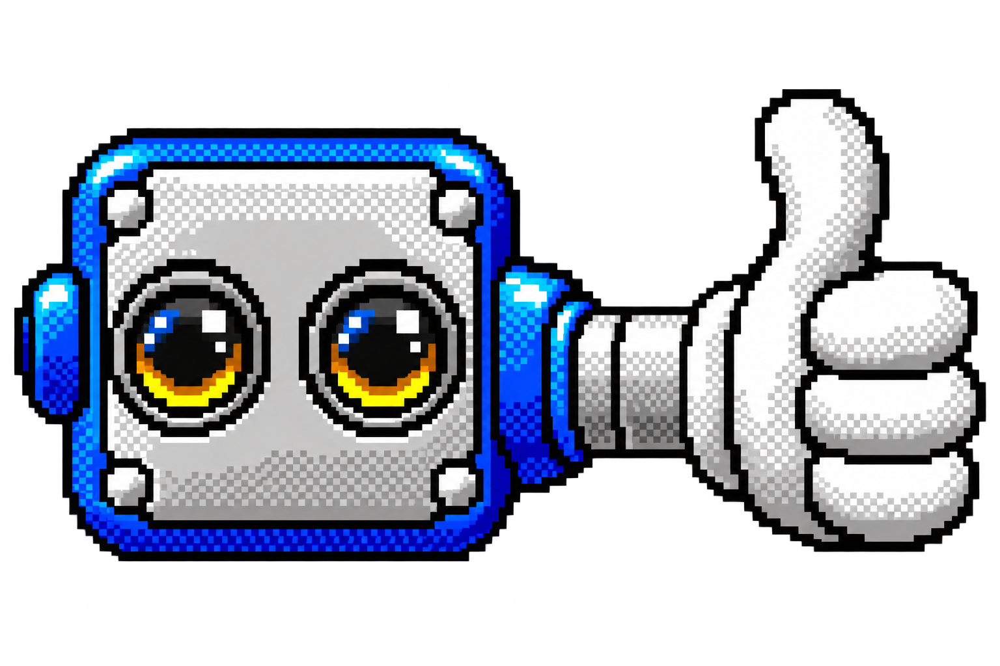

# Agentic Collaborative Wiki
A collaborative knowledge workspace for small academic and research teams, exploring how an AI agent can help organize and maintain shared knowledge while people retain control over what becomes authoritative.

Term project for **INF 385T.13 Human-AI Interaction**, UT Austin iSchool, Fall 2026.

**Current phase:** interaction design and evaluation, alongside selective engineering experiments. The main user-testing artifact is a Figma wireframe/prototype. This repository contains project guidance, design records and workflow tooling; it does not contain a runnable wiki application.

[Figma wireframes](https://www.figma.com/design/fm5zX32mbG13hahShVgJwd/Agentic-Collaborative-Wiki) · [User flows and scenarios](https://www.figma.com/board/zWKFoZeOtzEHpC25y2mg98/User-Flow-and-Scenarios?node-id=88-1085) · [Current issues](https://github.com/Agentic-Collaborative-Wiki-HAI/agentic-wiki/issues) · [Spike index](TODO.md)

## The question
> How can people delegate knowledge work to an agent in a shared workspace while understanding its evidence, reviewing its proposed changes, and retaining an accountable history?

The design connects source material, documentation and conversation. A lab member might upload an orientation recording, consult its transcript, ask a question about an instruction, or request a correction. The interface needs to make the source and scope of an agent's answer or proposed edit clear enough for someone else to judge it.

We are investigating whether this review process provides useful oversight without making review harder than doing the work manually. The wireframes express design hypotheses; their existence does not establish that the interactions work well for users.

## Project scope and deliverables
The research/design and technical work proceed in parallel. User testing does not depend on selecting a platform or completing an integrated application.

- **Research:** understand existing knowledge-management practices, delegation boundaries and trust concerns through generative research and competitive analysis, then evaluate the proposed interactions with users.
- **Interaction design:** develop connected, user-testable flows for evidence intake, knowledge finding, human notes, proposed changes and review. Revise the design from evaluation findings; a second evaluation round is a stretch goal.
- **Technical exploration:** run bounded capability experiments and describe the system architecture and tradeoffs needed to demonstrate the agentic approach. A full production application is not a course deliverable.
- **Final presentation:** bring together the problem, research, design, evaluation findings and the engineering evidence actually obtained, with remaining uncertainties stated clearly.

The [design epic](https://github.com/Agentic-Collaborative-Wiki-HAI/agentic-wiki/issues/4), [evaluation epic](https://github.com/Agentic-Collaborative-Wiki-HAI/agentic-wiki/issues/5), [technical epic](https://github.com/Agentic-Collaborative-Wiki-HAI/agentic-wiki/issues/3) and [final presentation task](https://github.com/Agentic-Collaborative-Wiki-HAI/agentic-wiki/issues/29) carry the current scope and ownership.

## What the wireframes explore
Initial flow work covers two complementary groups:

| Flow group | Interactions |
| --- | --- |
| [Evidence capture, proposal review and correction — F1/F4/F8](https://github.com/Agentic-Collaborative-Wiki-HAI/agentic-wiki/issues/32) | Add source material, inspect grounded suggestions, and correct outdated or contradictory instructions through human review. |
| [Knowledge finding, human notes and maintenance — F2/F5/F9](https://github.com/Agentic-Collaborative-Wiki-HAI/agentic-wiki/issues/33) | Find and question shared knowledge, add human context alongside evidence, and surface maintenance concerns with proposed repairs. |

Supporting views explore recordings and transcripts, citations and margin notes, anchored comment threads, editing and tracked suggestions, chat, and revision history. Uploads, transcription, messages and review outcomes in these views are simulated prototype states, not implemented services. A broad set of screens is not a commitment to implement every depicted feature this semester.

The central review interaction is:

1. A person requests work, or an agent surfaces a concern with supporting context.
2. The agent presents a bounded proposed change and its rationale and sources.
3. A person examines the change in context, discusses it and accepts, rejects or requests a revision.
4. Accepted changes enter the shared record; the decision and associated discussion remain traceable.

Current follow-up work includes [wireframe QA](https://github.com/Agentic-Collaborative-Wiki-HAI/agentic-wiki/issues/35), [agent management and instruction scopes](https://github.com/Agentic-Collaborative-Wiki-HAI/agentic-wiki/issues/34), [connecting maintenance into the wider experience](https://github.com/Agentic-Collaborative-Wiki-HAI/agentic-wiki/issues/37), and a proposed [research-grounded Showroom](https://github.com/Agentic-Collaborative-Wiki-HAI/agentic-wiki/issues/36). These are open work, not completed or validated behavior. The [first user-testing round](https://github.com/Agentic-Collaborative-Wiki-HAI/agentic-wiki/issues/31) evaluates the initial wireframes.

## Commitments and boundaries
- **Human control over shared changes.** Agent-proposed changes to canonical shared knowledge require human review. Source/context, attribution and review outcomes must be inspectable. See [the review policy](docs/policies/0001-agent-proposes-humans-dispose.md).
- **Model independence.** Keep model access swappable and evaluate capability, cost and integration tradeoffs rather than binding the project to one provider. See [the model policy](docs/policies/0002-keep-the-model-swappable.md).
- **Evidence before implementation claims.** Distinguish a drawn interaction, a capability test and a working integrated system. Candidate tests are not test results.
- **Bounded technical scope.** Real-time co-editing/CRDTs, multi-agent orchestration, a full permissions system, federation, enterprise retrieval infrastructure and local model hosting for cost savings are outside the current implementation scope. Agent-initiated maintenance is a design exploration of concerns and human-reviewed repairs; it does not establish an unattended operating cadence or automatic-write policy.
- **Public-repository privacy.** Keep credentials, raw participant data and private research records out of this repository. Public design examples and summaries must be safe to share.

## Technical questions
The [agent-stack investigation](https://github.com/Agentic-Collaborative-Wiki-HAI/agentic-wiki/issues/9) remains open. Capability experiments may examine intake/classification, organization, retrieval, citation, bounded proposals, review and maintenance. The choice of a wiki substrate or custom interface serves a specific experiment; it is not an up-front gate for design or evaluation.

Architecture work should explain the interface, knowledge storage, agent execution, retrieval/context, model access, provenance and review/history layers, including what was tested and what remains hypothetical. This repository does not yet define application installation, deployment or model-credential configuration.

<h2> Get set up with your agent</h2>

Copy this prompt into your agent while working in this repository. It covers general project onboarding; design-tool setup is offered when relevant to your work.

```text
Help me get set up to contribute to this Agentic Collaborative Wiki repository. Read README.md and AGENTS.md first, inspect Git and submodule state without overwriting local work, and initialize missing pinned submodules recursively without updating to remote tips or resetting dirty checkouts. Read TODO.md and the relevant project policies, then orient me to the project's purpose, scope, repository layout, current work and available validation. Ask what I want to contribute before starting implementation or creating work records.

Highlight the two workflow collections available here: project-workflows for planning, spikes, contribution coordination and commits, and wireframe-workflows for design-file organization, exploration, components and prototype work. Read the top-level project-workflows/workflow.toml and use its project-local procedures for project records; use the pinned wireframe-workflows procedures for design work. Project instructions and pinned skills take precedence over global copies. Explain any actual development prerequisites from the repository rather than assuming an application stack exists.

If I will work on wireframes, read design-files.json, docs/design/wireframe-conventions.md and wireframe-workflows/setup-wireframe-workflows/SKILL.md. Establish which owner's pages I will work on and preserve everyone else's work. Check my chosen agent client for an existing design-tool connection. If Figma or Penpot is missing, guide the selected provider's installation, authentication and read-only file verification through that setup skill instead of stopping at a missing connector. Let me complete account authorization and secret entry securely; continue independent repo onboarding while those steps are pending. Offer optional global workflow skill discovery for my chosen clients using each collection's documented procedure, previewing changes and preserving existing installations. Do not install unrelated integrations, change design files or sharing, publish branches, or push during onboarding. Finish with what is ready, what needs my action, and an appropriate first contribution based on my interests.
```

### Available workflows and wireframe context
- [Project Workflows](project-workflows/README.md): project planning, spike records, contribution coordination and scoped commits. The top-level collection governs this repository's work records.
- [Wireframe Workflows](wireframe-workflows/README.md): design organization, exploration, components and prototype work, including [Figma/Penpot connection setup](wireframe-workflows/setup-wireframe-workflows/SKILL.md#3-connect-and-check-the-design-tool). Neither collection requires global installation for use in this repository.

The [file manifest](design-files.json), [project conventions](docs/design/wireframe-conventions.md) and [board lookup](docs/design/figma-board-map.json) locate the design work. Workshops and Scratchpads preserve individual ownership; the Archive is shared. Aslan's work uses the recorded numbering conventions; Erwin's existing work retains its own conventions until he chooses to adopt them.

For a fresh clone:
```sh
git clone --recurse-submodules https://github.com/Agentic-Collaborative-Wiki-HAI/agentic-wiki.git
```

For an existing clean clone, initialize missing pinned dependencies with `git submodule update --init --recursive`; inspect dirty submodules before doing so. The parent pin selects the version. `.gitmodules` records `project/agentic-wiki` for future updates, but setup must not use `--remote` to substitute a newer revision.

Global links are optional convenience, not the source of project authority. The installer supports Codex and Claude Code and refuses conflicts. Other agents can read the same `SKILL.md` files directly. See the [adoption verification](docs/active-spikes/wireframe-workflow-adoption.todo.md#onboarding-follow-up-publication) for the published revisions and fresh-clone checks. Future collection updates follow the adopted [Project Workflows](project-workflows/update-project-workflows/SKILL.md) and [Wireframe Workflows](wireframe-workflows/update-wireframe-workflows/SKILL.md) update procedures.

## How we work
People select contributions through the team's issues and project board. Those are the live coordination surface; [TODO.md](TODO.md) indexes repository spikes rather than duplicating every task. Some older planning entries retain historical dates, so use the current issue for scheduling and ownership.

A spike is a bounded piece of work with a concept document and task record. Current guidance lives in `docs/policies/`; exploration stays in scratch material and completed records remain in the archive. See [the work vocabulary](docs/policies/0003-how-we-name-and-organize-work.md) and [AGENTS.md](AGENTS.md) for contribution, privacy and commit rules. Read project instructions before editing, and preserve other contributors' work.

## Repository layout
```text
docs/
  active-spikes/      scoped work, reasoning and task records
  policies/          current project guidance
  design/            wireframe conventions and board lookup
  scratch/           exploratory notes, not authoritative
  archive/           historical work records
assets/              README imagery
project-workflows/   pinned project procedures and configuration
wireframe-workflows/ pinned wireframe procedures and policies
design-files.json    design files, page roles and ownership
skills/              independent skill-authoring guidance
TODO.md              repository spike index
AGENTS.md            agent instructions and contribution rules
```

## License
[AGPL-3.0](LICENSE).
