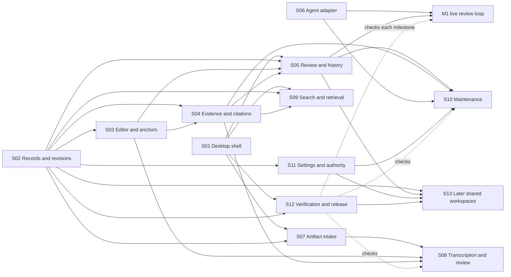

# Implementation planning
Opened 2026-11-17. Slug: `implementation-planning`. Owner: Aslan’s agent in the current implementation-planning conversation. [Planning tasks and verification](implementation-planning.todo.md). This spike coordinates a bounded planning phase; the approved foundation slice is active. Each child spike owns its execution details, and the map here records dependencies and integration outcomes.

## Purpose and authority
Plan and begin the local Agentic Wiki desktop application after the course presentation. Aslan approved D1–D5 and authorized foundation work plus editor/Rust and Codex feasibility checks on 2026-11-17. Activate S01/S02/S03/S06 and the initial S12 verification work. Later implementation slices are not complete merely because they are planned. The 2026-11-17 continuation authorizes a local foundation commit and the full M1 review journey, starting with model isolation. No Figma changes, external posts, pushes or standing policy amendments are authorized.

The agreed foundation is the existing repository, `app/`, Tauri + Vue + Rust, initial operation on Aslan’s Mac with Codex subscription access, the approved Prototype as design baseline, and replaceable model access. The following decisions are approved implementation direction, not amendments to standing policies:

- D1: The first release serves one real local operator and workspace, beginning with the passage-to-reviewed-edit journey. Genuine multi-person access follows as a separate phase.
- D2: Store structured documents and relationships in SQLite using versioned JSON and SQLx migrations. Copy imported originals into managed storage. Provide portable full-fidelity export and readable Markdown export.
- D3: Use open-source Tiptap/ProseMirror with bounded custom extensions. First prove one rich-text passage replacement across Vue and Rust before expanding the editing model.
- D4: Any change to a proposal’s base document revision initially requires refreshing and reviewing it before acceptance.
- D5: The agent receives only context selected or retrieved through permitted app workspace tools, with no ambient laptop/LifeOS/connector/shell access and no automatic paid API fallback.

D6 transcription, D7 semantic-search delivery and D8 maintenance execution remain deferred for a later discussion. This continuation does not expand teammates’ course commitments or assign them work.

## Evidence and freshness
Checked 2026-11-17. Local `main` and its local `origin/main` reference point to `71f4a1e`; GitHub’s actual `main` is `fda5d75241f22be61c9bf614f40df9c77d1f3dbc`. The checkout has ten pre-existing modified files. Planning preserves them, with only an additive entry in `TODO.md`. No pull, reset, checkout switch or submodule update was used to reconcile evidence. A later implementation start must integrate against the current published baseline while preserving this checkout’s work.

The [published release record](https://github.com/Agentic-Collaborative-Wiki-HAI/agentic-wiki/blob/fda5d75241f22be61c9bf614f40df9c77d1f3dbc/docs/design/prototype-release-2026-11-13.md), [published Prototype map](https://github.com/Agentic-Collaborative-Wiki-HAI/agentic-wiki/blob/fda5d75241f22be61c9bf614f40df9c77d1f3dbc/docs/design/prototype-board-map.json), [#40](https://github.com/Agentic-Collaborative-Wiki-HAI/agentic-wiki/issues/40) and its [promotion comment](https://github.com/Agentic-Collaborative-Wiki-HAI/agentic-wiki/issues/40#issuecomment-6866399942) establish the November 13 promotion. The connected Figma metadata read on 2026-11-17 returned the complete Prototype page `1469:30533`, with 246 top-level frames matching the release map. This verifies identities/names/structure, not fresh playback or all visual details. The existing release record supplies the earlier bounded playback evidence.

Live inspection also confirmed the Maintenance table has page/reason filters, sort controls, two suggestion rows and an empty result state. The release-era issue comment describes an older simple list; the table is the current design source. Some remote and local Staging concept/task records still say Prototype is empty or pending promotion. Those claims do not override the release and live page. Do not read their historical statements about source-change citation flags as the latest decision.

The remote tree contains design/workflow documentation and no app scaffold. The former architecture/platform/model/corpus/propose-edit issues [#2](https://github.com/Agentic-Collaborative-Wiki-HAI/agentic-wiki/issues/2), [#9](https://github.com/Agentic-Collaborative-Wiki-HAI/agentic-wiki/issues/9), [#10](https://github.com/Agentic-Collaborative-Wiki-HAI/agentic-wiki/issues/10), [#11](https://github.com/Agentic-Collaborative-Wiki-HAI/agentic-wiki/issues/11), [#12](https://github.com/Agentic-Collaborative-Wiki-HAI/agentic-wiki/issues/12) and token automation [#17](https://github.com/Agentic-Collaborative-Wiki-HAI/agentic-wiki/issues/17) are closed `not_planned`; their text is useful history, not a current assignment. [#3](https://github.com/Agentic-Collaborative-Wiki-HAI/agentic-wiki/issues/3) remains open as the course technical epic. [#34](https://github.com/Agentic-Collaborative-Wiki-HAI/agentic-wiki/issues/34) is completed design work; [#39](https://github.com/Agentic-Collaborative-Wiki-HAI/agentic-wiki/issues/39) still covers missing failure/recovery design and [#43](https://github.com/Agentic-Collaborative-Wiki-HAI/agentic-wiki/issues/43) records an accepted-page Cancel regression. No issue was reopened, changed or created. The new planning scope comes from Aslan’s current request.

## Design routes and coverage
These are inspected Prototype identities, not a promise that every depicted behavior is already specified or implemented. UI integration uses reusable stateful views, not 246 separately coded screen copies.

| Route family | Prototype source | Owning drafts |
| --- | --- | --- |
| Home, tree, equipment and page navigation | [Home](https://www.figma.com/proto/fm5zX32mbG13hahShVgJwd?node-id=2621-85891&scaling=scale-down-width&hide-ui=1) · [Equipment](https://www.figma.com/proto/fm5zX32mbG13hahShVgJwd?node-id=2621-105411&scaling=scale-down-width&hide-ui=1) · [Centrifuge overview](https://www.figma.com/proto/fm5zX32mbG13hahShVgJwd?node-id=2621-105343&scaling=scale-down-width&hide-ui=1) | S01, S02 |
| Page creation, direct edit, tracked human edits | [Add page](https://www.figma.com/proto/fm5zX32mbG13hahShVgJwd?node-id=2621-90971&scaling=scale-down-width&hide-ui=1) · [Edit](https://www.figma.com/proto/fm5zX32mbG13hahShVgJwd?node-id=2621-89772&scaling=scale-down-width&hide-ui=1) · [Track changes](https://www.figma.com/proto/fm5zX32mbG13hahShVgJwd?node-id=2621-89918&scaling=scale-down-width&hide-ui=1) | S02, S03, S05 |
| Comment → explicit agent request → proposal | [Select text](https://www.figma.com/proto/fm5zX32mbG13hahShVgJwd?node-id=2621-88830&scaling=scale-down-width&hide-ui=1) · [Ask agent](https://www.figma.com/proto/fm5zX32mbG13hahShVgJwd?node-id=2621-89154&scaling=scale-down-width&hide-ui=1) · [Proposal](https://www.figma.com/proto/fm5zX32mbG13hahShVgJwd?node-id=2621-89285&scaling=scale-down-width&hide-ui=1) | S03, S04, S05, S06 |
| Revise/edit proposal, accept/reject, resolve, history | [Request revision](https://www.figma.com/proto/fm5zX32mbG13hahShVgJwd?node-id=2621-87028&scaling=scale-down-width&hide-ui=1) · [Edit proposal](https://www.figma.com/proto/fm5zX32mbG13hahShVgJwd?node-id=2621-87499&scaling=scale-down-width&hide-ui=1) · [History](https://www.figma.com/proto/fm5zX32mbG13hahShVgJwd?node-id=2621-98958&scaling=scale-down-width&hide-ui=1) | S02, S05 |
| Chat questions and cited answers | [Open Chat](https://www.figma.com/proto/fm5zX32mbG13hahShVgJwd?node-id=2621-93882&scaling=scale-down-width&hide-ui=1) · [Cited answer](https://www.figma.com/proto/fm5zX32mbG13hahShVgJwd?node-id=2621-94018&scaling=scale-down-width&hide-ui=1) | S01, S04, S06, S09 |
| Recording/audio-note intake through modal or Chat | [Intake](https://www.figma.com/proto/fm5zX32mbG13hahShVgJwd?node-id=2621-86160&scaling=scale-down-width&hide-ui=1) · [Chat-created recording](https://www.figma.com/proto/fm5zX32mbG13hahShVgJwd?node-id=2621-104906&scaling=scale-down-width&hide-ui=1) · [Audio note](https://www.figma.com/proto/fm5zX32mbG13hahShVgJwd?node-id=2621-93511&scaling=scale-down-width&hide-ui=1) | S06, S07, S08 |
| Transcript edit/review and timestamped notes | [Recording](https://www.figma.com/proto/fm5zX32mbG13hahShVgJwd?node-id=2621-101596&scaling=scale-down-width&hide-ui=1) · [Review](https://www.figma.com/proto/fm5zX32mbG13hahShVgJwd?node-id=2621-101838&scaling=scale-down-width&hide-ui=1) · [Timestamped note](https://www.figma.com/proto/fm5zX32mbG13hahShVgJwd?node-id=2621-102088&scaling=scale-down-width&hide-ui=1) | S03, S04, S07, S08 |
| Wiki/web/DOI/print/audio citations; links; notes; reused text | [Citation picker](https://www.figma.com/proto/fm5zX32mbG13hahShVgJwd?node-id=2621-105975&scaling=scale-down-width&hide-ui=1) · [Manual source](https://www.figma.com/proto/fm5zX32mbG13hahShVgJwd?node-id=2621-105989&scaling=scale-down-width&hide-ui=1) · [Reused passage](https://www.figma.com/proto/fm5zX32mbG13hahShVgJwd?node-id=2621-89592&scaling=scale-down-width&hide-ui=1) | S03, S04, S09 |
| Long-page contents, rail and endnotes | [Planning page](https://www.figma.com/proto/fm5zX32mbG13hahShVgJwd?node-id=2621-99503&scaling=scale-down-width&hide-ui=1) · [Long-page edit](https://www.figma.com/proto/fm5zX32mbG13hahShVgJwd?node-id=2621-99743&scaling=scale-down-width&hide-ui=1) | S01, S03, S04 |
| Search and concept retrieval | [Search](https://www.figma.com/proto/fm5zX32mbG13hahShVgJwd?node-id=2621-100665&scaling=scale-down-width&hide-ui=1) · [Concept results](https://www.figma.com/proto/fm5zX32mbG13hahShVgJwd?node-id=2621-105551&scaling=scale-down-width&hide-ui=1) | S09 |
| Maintenance and changed-source booking correction | [Queue](https://www.figma.com/proto/fm5zX32mbG13hahShVgJwd?node-id=2621-102413&scaling=scale-down-width&hide-ui=1) · [Suggestion](https://www.figma.com/proto/fm5zX32mbG13hahShVgJwd?node-id=2621-100896&scaling=scale-down-width&hide-ui=1) · [Accept](https://www.figma.com/proto/fm5zX32mbG13hahShVgJwd?node-id=2621-101018&scaling=scale-down-width&hide-ui=1) · [Reject](https://www.figma.com/proto/fm5zX32mbG13hahShVgJwd?node-id=2621-101141&scaling=scale-down-width&hide-ui=1) | S04, S05, S06, S10 |
| Wrong-source correction and Undo | [Centrifuge review](https://www.figma.com/proto/fm5zX32mbG13hahShVgJwd?node-id=2621-103101&scaling=scale-down-width&hide-ui=1) · [Reverted decision](https://www.figma.com/proto/fm5zX32mbG13hahShVgJwd?node-id=2621-103701&scaling=scale-down-width&hide-ui=1) | S04, S05, S09, S10 |
| Settings, protection, reviewer transfer and onboarding | [Delegation](https://www.figma.com/proto/fm5zX32mbG13hahShVgJwd?node-id=2621-102667&scaling=scale-down-width&hide-ui=1) · [Protection](https://www.figma.com/proto/fm5zX32mbG13hahShVgJwd?node-id=2621-102914&scaling=scale-down-width&hide-ui=1) · [Transfer](https://www.figma.com/proto/fm5zX32mbG13hahShVgJwd?node-id=2621-102516&scaling=scale-down-width&hide-ui=1) · [Onboarding](https://www.figma.com/proto/fm5zX32mbG13hahShVgJwd?node-id=2621-102595&scaling=scale-down-width&hide-ui=1) | S11; genuine shared operation S13 |
| Delegated URL repair, notification and history | [Repair event](https://www.figma.com/proto/fm5zX32mbG13hahShVgJwd?node-id=2621-102963&scaling=scale-down-width&hide-ui=1) · [Undo](https://www.figma.com/proto/fm5zX32mbG13hahShVgJwd?node-id=2621-103033&scaling=scale-down-width&hide-ui=1) | S05, S10, S11 |
| Failure/recovery, backup, platform release | [#39](https://github.com/Agentic-Collaborative-Wiki-HAI/agentic-wiki/issues/39); not comprehensively drawn | S12 plus each feature owner |

The launcher itself is a prototype navigation aid, not a required product page. Handover writing, Procedure subtypes, the check-log exploration, F13 Agents overview/Needs your input and the removed Related Pages placeholder are not silently reintroduced. Search refinements tried only in Workshop and Showroom explanatory graphics are separate from the released UI.

Preserve the adopted behaviors: one orientation recording beneath Getting started; typed objects/provenance without visible evidence tiers; separate wiki tree and page contents; centered bounded text; sticky opaque rail tabs; context-preserving previews; Chat waits for a human prompt; editable/reviewable whole transcripts; human notes separate from spoken text; independent discussion resolution and proposal decisions; reviewer role independent of authorship; no silent substantive edits. The source-change case is a proposed wording-and-citation repair with history, not a generic citation revision badge standing in for review.

## Foundation checkpoint — 2026-11-17
The first `app/` implementation runs as a native macOS window. It has the shared page shell, two fictional example records, bounded editing, autosaved drafts, transactional saves and revision history. The real ProseMirror/Rust replacement contract agrees on ten valid fixtures and rejects four malformed range/quote fixtures in both runtimes. [Run/setup instructions](../../app/README.md) and [exact verification](app-release-quality.todo.md#foundation-verification--2026-11-17) are maintained separately from this map.

The Codex check produced a negative isolation result, not a failed subscription login. ChatGPT sign-in is available, but this installed app-server build inherits global instructions and a loopback-only request inspection still sees additional tools. The Codex generation path remains disconnected. S06 uses a separately authorized app-owned connection with explicit context and no tools. Its live native verification is recorded below; the inherited coding session is not used for product inference.

## Proposed workstreams
S01–S06 and the initial S12 checks are active. The other six children remain draft scratch briefs. The IDs below are planning references, not Figma numbering or permanent product identities. Future work is not active or assigned merely because it appears here.

The existing `.gitignore` rule `scratch/` ignores these new briefs. They are local planning records at this stage. Before a later publication, deliberately include the reviewed drafts or promote them and repair the map links; do not publish an index that depends on missing files. This planning phase does not change ignore rules or stage files.

| ID and brief | First contribution | Completion prerequisites |
| --- | --- | --- |
| [S01 · Desktop foundation and shared interface](app-desktop-foundation.md) | M0–M1; extend through M4 | Independent feasibility/contracts |
| [S02 · Knowledge records, revisions and local storage](app-knowledge-store.md) | M0–M1; migration and backup support through M5 | Independent feasibility/contracts |
| [S03 · Rich-text editing and durable passage anchors](app-editor-anchors.md) | M0 feasibility; M1 editor; M3 broader authoring | S02 |
| [S04 · Source evidence, citations and margin notes](app-evidence-citations.md) | M1 minimum references; M2–M3 full authoring | S02, S03 |
| [S05 · Suggestions, discussion, decisions and history](app-proposal-review.md) | M1 first integrated milestone; M3 full review variants | S01, S02, S03, S04 |
| [S06 · Subscription-backed agent runtime and context boundary](app-agent-runtime.md) | M0 feasibility; M1 live proposal; later retrieval integration | Independent feasibility/contracts |
| [S07 · Artifact intake, managed files and audio playback](../scratch/app-artifact-intake.md) | M2 | S01, S02 |
| [S08 · Local transcription and whole-transcript review](../scratch/app-transcript-review.md) | M2 | S02, S03, S04, S07 |
| [S09 · Wiki search, source finding and grounded answers](../scratch/app-search-retrieval.md) | M3; semantic retrieval is a separate gate within this spike | S01, S02, S04 |
| [S10 · Maintenance queue, source changes and delegated repairs](../scratch/app-maintenance.md) | M4; narrow automation after its authority gate | S02, S04, S05, S06, S11 |
| [S11 · Settings, reviewer responsibility and action authority](../scratch/app-settings-reviewers.md) | M1 minimal actor guard; M4 local settings; shared operation in S13 | S02 |
| [S12 · Continuous verification, recovery and desktop release](app-release-quality.md) | M0 harness; checks at every milestone; M5 release | S01, S02 |
| [S13 · Later shared workspaces and genuine multi-person review](../scratch/app-shared-workspaces.md) | After M5; separate scope decision before activation | S02, S05, S11, S12 |

S13 is deliberately separate: local settings can illustrate reviewer state, but genuine collaboration needs authenticated people and shared state. Retaining that future brief prevents “local demo complete” from becoming a claim that the collaborative product is complete.

## Dependency graph and rough order
Solid arrows are data/behavior prerequisites for completed integration. They do not require every feature in the upstream spike to finish before a downstream contract experiment starts. Dashed edges are ongoing verification, not release gates that create a dependency cycle.

| Milestone | Demonstrable result and exit | Rough implementation order |
| --- | --- | --- |
| M0 · Resolve integration risks | App window and test harness start; document JSON/anchor/patch round trip has a verified contract; a bounded subscription request is proven after approval. Failure yields a concrete alternative before dependent implementation. | Thin S01/S02 foundations; S03 editor probe and S06 access probe are independent; S12 harness starts here. |
| M1 · First integrated product checkpoint | Getting started: select booking instruction → comment → explicitly ask agent → inspect evidence and proposal → revise/accept/reject → history → restart. Deterministic fixtures and a real model request have separately recorded results. | Minimum S02/S03/S04 contracts → S05 route; S06 joins once the review engine is safe. S11 contributes a minimal local actor check, not the whole settings UI. |
| M2 · Real evidence intake | Drop a non-sensitive recording into Chat, confirm type/title, add, generate transcript, play/correct/review, annotate and cite it. Retry/cancel/restart are real. | S07 media lifecycle → S08 processing; extend S04 evidence and S06 orchestration. The no-transcript branch works independently. |
| M3 · Usable local wiki | Create/edit pages, browse real overviews, find sources, author citations/notes, read long pages, ask cited questions and exercise human tracked proposals. | Finish broader S01/S03/S04 authoring and S09 lexical retrieval; semantic retrieval remains a measured gate, not a fake mode. |
| M4 · Maintenance and controlled delegation | Queue points to the same page proposal; changed-source acceptance/rejection is correct. Local protection/reviewer settings work. Narrow automatic repair is enabled only after its separate authority gate. | S11 settings + S10 queue/checks; the existing S05 engine is reused. |
| M5 · Dependable local release | Scoped routes pass native desktop checks, backup restores into a fresh directory, failure recovery and migrations are tested, and a Mac package is reproducible. | S12 collects feature-owned evidence throughout M0–M4, then verifies the complete included release. |
| Later · Shared collaboration | Two real authenticated people can hand over review and act on common data without unsafe concurrent writes. | Activate S13 only after a separate scope/deployment decision. |

M2 before M3 is a useful delivery preference, not a hard prerequisite: lexical retrieval and broader wiki editing can proceed from seeded documents while transcription is being measured. The editor and model-access probes are independent. Maintenance table UI can start from existing proposals; automatic repair cannot. Do not wait for semantic retrieval, real audio, a scheduler or a complete permission system to prove M1.

## First milestone and why
Retain the booking-instruction review loop as the first integrated milestone because it joins the hardest differentiating contracts: real text selection, persistent discussion, evidence, agent output, human decision and atomic history. A shell-only or Chat-only demo could look complete while leaving those contracts untested. Starting with audio adds decoding and transcription latency before we know the core review mechanism works.

Use the actual Getting started route: its outdated shared-spreadsheet instruction is compared with the orientation transcript’s booking-calendar guidance. The Using the microscope/Booking sheet r4→r5 example is a second atomic-update fixture for the same engine and later becomes the Maintenance route. Do not splice their source stories together or rename the pages to conceal that distinction.

M1 completion criteria:
- A user can enter arbitrary comment text and explicitly request a proposal; navigation or an ordinary comment alone does not invoke the agent.
- Evidence opens the correct source revision/passage and returns to the same pending proposal.
- Accept writes the exact reviewed wording and citation together; Reject preserves both, records a decision and does not invent a content revision.
- Request revision/human-edit proposal preserve the original proposal’s provenance. Resolve thread is independent of decision.
- Repeated acceptance cannot double-apply; a changed base revision produces an explicit stale state, not an overwrite.
- Restart restores document, pending/decided proposal and conversation. Edit → Cancel after acceptance retains the accepted content (issue #43 regression).
- Meaningful Rust/JS contract tests and an actual Tauri walkthrough pass. A live subscription run is recorded separately from deterministic fixtures, with errors shown honestly.
- Aslan reviews the interaction before expansion is declared accepted. Planning approval alone does not grant QA acceptance.

## Interface ownership and integration checks
Ownership means the proposed spike that maintains a contract and its tests; no human teammate or additional agent has been assigned.

| Contract | Owner and consumers | Required joint check |
| --- | --- | --- |
| Object/revision/actor IDs; schema version; atomic commit | S02; all consumers | Round-trip identity, malformed/unknown version rejection, rollback and duplicate command handling |
| Editor schema, operations, current/historical passage anchors | S03 with S02 validation; S04/S05/S08 | Unicode, split/merge/deletion, ambiguous quote and restart conformance across JS/Rust |
| Source reference and typed provenance | S04; S05/S08/S09/S10 | Pinned source/locator survives edits; claim support stays a human judgment |
| Proposal/decision/thread state | S05; S06/S10/S11 | Same proposal on page/queue/history; no decision via Resolve; atomic wording+citation |
| Agent runs and permitted context/tools | S06; S05/S07/S09/S10 | Cancellation, quota, malformed results and no canonical-write/shell access |
| Media import identity and original files | S07; S08/S04/S12 | Partial copy recovery, real playback/time references and no duplicate imports |
| Transcript revisions/review/job state | S08; S04/S05/S12 | Review tied to exact revision; notes remain distinct; interrupted job resumes/retries honestly |
| Retrieval bundle/index invalidation | S09; S04/S06 | Revision-correct results and wrong-equipment/obsolete-source queries |
| Actor/action authorization | S11; S02/S05/S06/S10 | Backend rejects direct unauthorized calls; protection overrides delegation |
| Backup/restore and native acceptance harness | S12 with S02/S07; all | Fresh-directory restoration, secret exclusion, platform walkthrough and disabled test hooks |
| Authenticated shared transport | S13; existing domain core | Two real sessions, concurrency/revocation and identity-preserving migration |

Shared seams should be drafted before implementation depends on them, without a generic package framework. Start with one Rust application crate organized into domain, storage, integrations and Tauri adapters, plus Vue feature modules. Extraction into additional crates/packages should follow an actual reuse need. Persisted rich content requires an explicit schema and migration plan; it is not an unversioned JSON bag.

## Proposed product/storage model
Pages and source artifacts have stable IDs; hierarchy is a relationship and does not encode identity. Documents have immutable published revisions and separately recoverable drafts. Citations point to an exact source revision and optional passage/time/page locator. A proposal carries its base revision, bounded operations, rationale, evidence and generation attribution. The decision records who acted and what was published. Comments, authored notes, generation and review events stay separate from source text.

D2 selects SQLite plus schema-versioned editor JSON and managed original files. A portable export includes records and files with a version/checksum manifest; a readable Markdown export is useful but cannot itself round-trip all anchors, proposals and review history. If editable-on-disk Markdown is a primary requirement, decide before implementing storage rather than adding a nominal export and pretending it is equivalent.

The initial editor/Rust feasibility check proves a bounded single-paragraph replacement, including UTF-16 boundaries, inline marks, citation atoms and exact-quote preconditions. Broader edit operations remain unimplemented. The implemented contract uses a small schema-aware replacement operation with explicit preconditions; it neither executes arbitrary JS in Rust nor trusts model-supplied whole-document output. Compare with an editor-generated transaction whose result the backend independently validates. Do not quietly recreate all of ProseMirror in Rust or add a Node sidecar without reviewing the tradeoff.

## Decisions and unanswered questions
This is an ordinary working decision inventory, not the approval slate. The complete approval slate is presented in chat; D1–D5 are approved above; D6–D8 remain deferred.

Resolved for foundations by D1–D5:
- Release boundary: one real local operator/workspace is approved for the first release, with labeled fixture actors; preserve genuine multi-person operation in S13.
- Canonical document/storage choice: use open-source Tiptap/ProseMirror, schema-versioned JSON and SQLite/SQLx, managed originals and portable export. The material alternative is a file-first Markdown model with separate metadata/anchor reconciliation.
- Stale proposals: require explicit refresh/re-review on any changed base revision initially. Comment anchors may map through non-overlapping edits, but that does not authorize an old proposal against a new revision.
- Model context: allow only app-selected/retrieved workspace content for a deliberate request, with inspectable evidence/context, no ambient filesystem/vault access and no automatic paid fallback. “Local app” does not mean model inference stays on the laptop.

Can wait until the relevant milestone:
- Transcription: recommend a measured local whisper.cpp worker and manual/imported transcript fallback; model size, format limits and optional speaker diarization are unresolved. Hosted audio would require a separate cost/privacy choice.
- Search: recommend lexical retrieval first and a separate local semantic evaluation before enabling a concept-search mode. Embedding runtime/model and its licensing/resource requirements are undecided.
- Maintenance execution: the moved-link design is approved, but trigger/cadence, same-source proof and runtime permission implementation are not settled. Recommend user-requested checks first; no auto-repair until the narrow authority gate is resolved.
- Real collaboration: deployment, workspace ownership, identity provider, invitation delivery, sync and model-account arrangement belong to S13 and need a later scope decision.
- Distribution: code signing, updater, other operating systems and public releases can wait. No spend or public distribution is authorized now.

Routine defaults that do not require another preference round: typed command contracts, unique stable object IDs, original-source preservation, disposable test databases, deterministic provider fixtures, bounded retries, public-safe demo content, and feature-owned tests from the start. They remain reversible implementation recommendations, not new standing policies.

## Policy and documentation reconciliation needed later
The current planning request authorizes this post-presentation exploration despite the course-era bounded scope; it does not amend the standing policies. The model-portability policy still applies. The design’s explicitly delegated repair example and the review policy’s blanket automatic-maintenance exclusion need an exact operational reconciliation before such writes are enabled. Record that gate without reopening the settled design discussion or manufacturing team agreement.

After implementation is authorized, prepare scoped README/validation updates that distinguish the runnable local app from the earlier course deliverable, and integrate planning docs with the newer published branch without overwriting concurrent work. Closed course tickets remain historical unless the user separately authorizes new coordination work. The request here does not authorize a GitHub backlog rewrite.

## Primary technical evidence and limits
Sources checked 17 Nov 2026. These establish available mechanisms, not successful integration or measured performance:
- [Tauri project structure](https://v2.tauri.app/start/project-structure/) supports the nested app/ proposal. [Capabilities](https://v2.tauri.app/security/capabilities/) requires explicit care with application commands; desktop capability configuration is not the wiki’s reviewer-authorization model.
- [Tiptap persistence](https://tiptap.dev/docs/editor/core-concepts/persistence) supports JSON storage. [Tiptap overview](https://tiptap.dev/docs/editor/getting-started/overview) distinguishes open-source core from paid extensions. [ProseMirror mapping source](https://github.com/ProseMirror/prosemirror-transform/blob/master/src/map.ts) exposes position/deletion mapping; durable semantic anchors across revisions still require our design and tests. The ProseMirror reference site returned 403, so its primary source was consulted instead.
- [Codex app-server](https://learn.chatgpt.com/docs/app-server) documents managed local auth, streaming, account limits and experimental dynamic tools. Installed protocol inspection and a read-only Rust probe confirm ChatGPT sign-in. A loopback request inspection found inherited global instructions and additional tool namespaces despite attempted capability restrictions. Generation remains disabled; no live inference was run. See S06 for the measured boundary failure. [Sign in with ChatGPT](https://developers.openai.com/cookbook/articles/sign-in-with-chatgpt) is an app-owned alternative for eligible local/open-source uses; account eligibility and end-to-end access are not proven by documentation.
- [Plan-usage limitations](https://developers.openai.com/siwc/token-sharing-open-source/preview-limitations) exclude audio/video input and transcription from that flow. No embeddings entitlement is assumed. [whisper.cpp](https://github.com/ggml-org/whisper.cpp) supports Apple Silicon and needs its own model/decoding setup; no weights were downloaded and no benchmark was run.
- [SQLite FTS5](https://www.sqlite.org/fts5.html) supplies lexical search, not vector retrieval. [SQLite backup](https://www.sqlite.org/backup.html) describes consistent snapshots; attachment consistency and secret exclusion remain application responsibilities.
- [Tauri desktop testing](https://v2.tauri.app/develop/tests/webdriver/) currently documents a WebdriverIO embedded-server path on macOS. The standalone tauri-driver limitation must not be generalized to all Tauri testing. The embedded WebDriver method passed actual macOS window, editing, draft/revision restart, selection and sticky-tab checks. Instrumentation is behind an opt-in debug feature that refuses release compilation.

The original planning pass claimed no application execution. The approved foundation continuation has actual native-app and editor/storage evidence in [S12](app-release-quality.todo.md#foundation-verification--2026-11-17). It does not establish a live model response, transcription benchmark, Figma playback or human QA. The approved Prototype is the baseline, while issue #43 and explicit source/release discrepancies remain exceptions to verify rather than copy blindly.

Continues in: docs/active-spikes/app-desktop-foundation.md

Continues in: docs/active-spikes/app-knowledge-store.md

Continues in: docs/active-spikes/app-editor-anchors.md

Continues in: docs/active-spikes/app-agent-runtime.md

Continues in: docs/active-spikes/app-release-quality.md

## M1 continuation — 2026-11-17
Aslan launched the foundation and approved its appearance, then authorized its local checkpoint and the full passage-to-review batch. The foundation is committed separately from the older design work; the mixed TODO index stays uncommitted. S04 and S05 are active. S06 implements the documented app-owned subscription connection with local boundary tests and a passing live native run. The approved context boundary is unchanged. The remaining human QA is the complete review interaction, not a renewed foundation design decision.

## Review implementation evidence
Persistent passage comments, evidence previews, proposed wording, human revisions, accept/reject and original/current revision history are implemented. The native app checks persistence and return paths with labeled test candidates; the app-owned OAuth adapter passes identity/context/stream validation tests. [M1 QA record](../design/app-review-qa-2026-11-17.md) distinguishes those fixture checks from the separate passing live subscription run. The live run covers cancellation/retry, revision, rejection, acceptance and restart; M1 awaits the requested hands-on interaction review.

## Prototype interaction alignment — 2026-11-17
Aslan confirmed that the live mechanics worked and requested the Prototype’s interaction: `@agent` in the passage discussion and proposed wording inline in the article. These are implemented, with connection/model preferences under Settings and draft-preserving return to the discussion. The article preview never changes stored JSON; acceptance remains the explicit wording-and-citation transaction. The bounded source context uses page citations and attached recordings, disclosed before sending. Human acceptance of the corrected interaction remains open; this is not completion of the broader Prototype.
