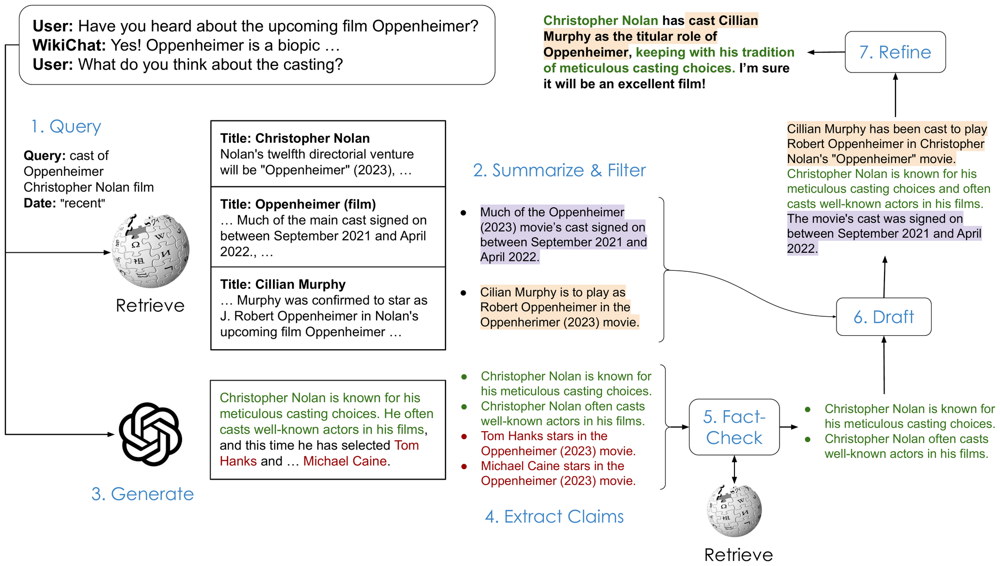
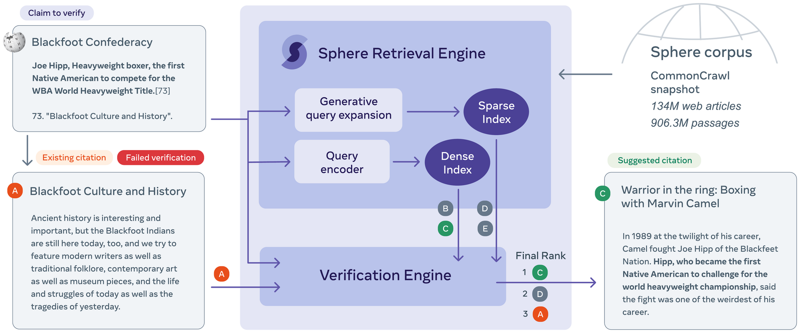
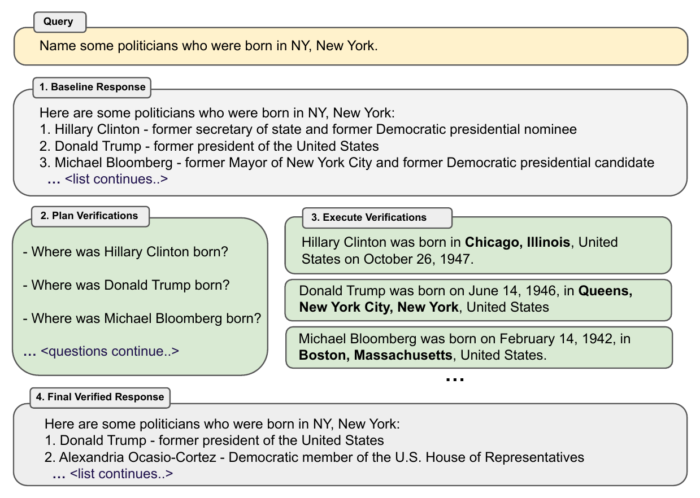
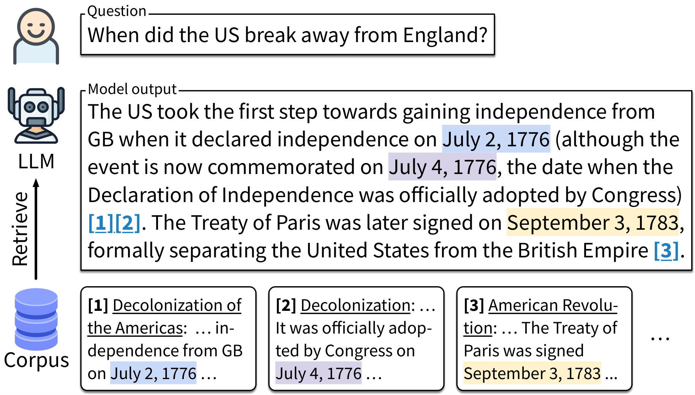
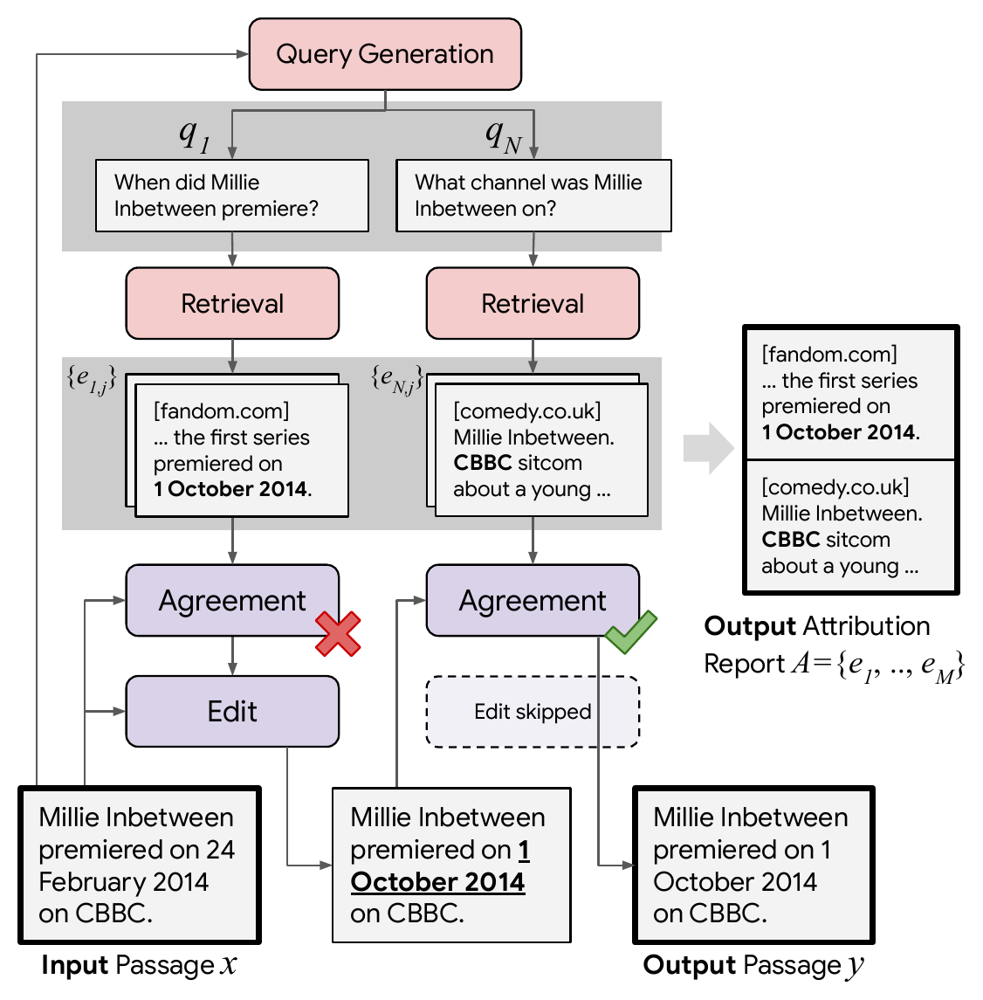
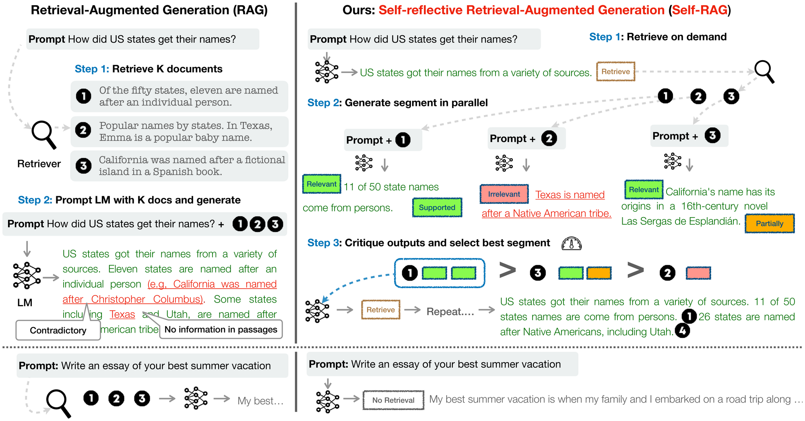

# Scenario A: Q&A

> Research notes and candidate applications. Paper findings are reported research; “For us,” “Application,” and proposed pipelines describe ideas to evaluate, not completed lab-wiki capabilities.

The core loop is “the agent proposes → a person reviews → the change enters the record.”

## Top picks

- **WikiChat** (A): a Q&A pipeline that retrieves from a wiki and fact-checks claims one by one. It is close to a prototype of scenario A.

- **SIDE, Petroni et al.** (A, “propose a fix when the wiki is wrong”): AI finds Wikipedia citations that do not support their claims and recommends sources for people to review.

- **Kim et al., “I’m Not Sure, But…”** (A, “say so when nothing is found”): expressing uncertainty in the first person reduces over-reliance.

## Scenario workflow

Steps on the canvas: understand the question → search_wiki / read_page → check that quotes really exist → the Verifier checks for anything beyond the sources → answer with page status and flag staleness → attach a proposal if the wiki is wrong; if nothing is found, say so and suggest who to ask.

### AI / NLP: answering with citations and checking them

| Paper | Venue | What it solves | What it means for us |
| --- | --- | --- | --- |
| [WikiChat](https://arxiv.org/abs/2305.14292), Semnani et al. | Findings of EMNLP 2023 | A Wikipedia-grounded chatbot: retrieve → extract claims → fact-check each → keep only supported content | Maps almost one-to-one onto A; first choice for baseline or related work |
| [Improving Wikipedia Verifiability with AI (SIDE)](https://arxiv.org/abs/2207.06220), Petroni et al. | Nature Machine Intelligence 2023 | Finds Wikipedia claims whose citations do not support them and recommends better sources for editors to judge | Matches “Fix: propose”: spot wiki problems while answering and hand them to people as proposals |
| [Chain-of-Verification](https://arxiv.org/abs/2309.11495), Dhuliawala et al. | Findings of ACL 2024 | Draft an answer, split it into verification questions answered independently, then revise | A concrete template for our Verifier |
| [Enabling LLMs to Generate Text with Citations (ALCE)](https://arxiv.org/abs/2305.14627), Gao et al. | EMNLP 2023 | Answers with citations, plus citation recall and precision metrics | Use these two metrics to evaluate citation support and coverage |
| [RARR](https://arxiv.org/abs/2210.08726), Gao et al. | ACL 2023 | Generate first, then retrieve evidence, revise unsupported parts and add attribution | When the Verifier finds content beyond the sources, revise instead of discarding |
| [Self-RAG](https://arxiv.org/abs/2310.11511), Asai et al. | ICLR 2024 | The model decides when to retrieve and judges whether its output is supported | Borrow its “is it supported” labels for the Verifier |
| [FreshLLMs](https://arxiv.org/abs/2310.03214), Vu et al. | Findings of ACL 2024 | Tests answers to knowledge that changes over time and improves them with fresh search results | Supports “answer with page status and flag staleness” |
| [Evaluating Verifiability in Generative Search Engines](https://arxiv.org/abs/2304.09848), Liu, Zhang & Liang | Findings of EMNLP 2023 | Audits Bing Chat, Perplexity and others; many sentences are not fully supported by their citations | Shows why citations cannot be left to the model; the quote check must be code |

### HCI: how people read and trust the answer

| Paper | Venue | What it solves | What it means for us |
| --- | --- | --- | --- |
| [LLMs Help Humans Verify Truthfulness — Except When They Are Convincingly Wrong](https://aclanthology.org/2024.naacl-long.81), Si et al. | NAACL 2024 | AI explanations help people fact-check, but convincing wrong explanations mislead; raw evidence is safer | Show the source passage with the answer, not only the AI summary |
| [“I’m Not Sure, But…”](https://arxiv.org/abs/2405.00623), Kim et al. | FAccT 2024 | First-person uncertainty from an LLM reduces over-reliance on wrong answers | Wording for “nothing found” or weak evidence |
| [Answer Garden 2](https://web.eecs.umich.edu/~ackerm/pub/96b22/cscw96.ag2.html), Ackerman & McDonald | CSCW 1996 | Organizational memory that escalates unanswered questions to the right colleagues | A classic CSCW precedent for “say so, and suggest who to ask” |
| [Guidelines for Human-AI Interaction](https://www.microsoft.com/en-us/research/publication/guidelines-for-human-ai-interaction/), Amershi et al. | CHI 2019 | 18 guidelines, e.g. “make clear how well the system can do what it can do” and “scope services when in doubt” | Rationale for “Answer: auto / Fix: propose” |

## Paper by paper: Scenario A (ranked by relevance to our system)

Within each scenario, papers are ranked from most to least relevant. Higher ones map directly onto a step of “propose → review → record”; lower ones are mostly background or design principles. Each entry covers the problem, the technical approach, the results, and what it means for us.

### 1. WikiChat: a Wikipedia-grounded chatbot that checks claims one by one

- **Problem:** Chatbots hallucinate most on tail (niche) and recent topics, which motivates testing the approach on an internal wiki; transfer to lab material remains a hypothesis.

- **Approach:** A seven-stage pipeline: (1) generate search queries and retrieve from Wikipedia; (2) summarize and filter the retrieved passages; (3) let the LLM write a free response; (4) extract the separate factual claims from that response; (5) fact-check each claim against retrieved evidence and keep only supported ones; (6) draft a reply from the curated facts only; (7) refine. The whole pipeline is then distilled into a 7B LLaMA model to cut cost and latency.

- **Results:** 97.3% factual accuracy in simulated conversations; 94.6% on tail topics (GPT-4: 56.0%) and 98.5% on recent topics (GPT-4: 47.5%).

- **For us:** Maps almost one-to-one onto A. Proposed extensions are page status in the answer and a proposal when the wiki is wrong. Their novelty and usefulness have not been established by this review.

System figure: [Figure 1](https://arxiv.org/abs/2305.14292), all WikiChat components and the seven stages, with a sample conversation.

*Source: Semnani et al. 2023, Figure 1 (*[arXiv:2305.14292](https://arxiv.org/abs/2305.14292)*).*

### 2. SIDE: improving Wikipedia verifiability with AI

- **Problem:** Many Wikipedia citations do not actually support their claims, and people cannot check them all by hand.

- **Approach:** Two components. **Retriever:** uses the claim and its context as the query, with sparse (BM25) plus dense retrieval over a web corpus (Sphere), to find candidate sources. **Verification engine:** a fine-tuned BERT that takes the claim and a candidate passage concatenated and scores how well they match. It is trained on Wikipedia’s existing citations. The system scores the current citation, flags low scores as suspect, and recommends higher-scoring candidates to editors, who decide.

- **Results:** For the citations flagged as most suspect, human raters preferred SIDE’s suggestion over the original 70% of the time. In a demo with the Wikipedia community, SIDE’s first recommendation collected over 60% more preferences than the existing citations.

- **For us:** The best precedent for “Fix: propose”: the AI only flags and recommends, never edits, and a person reviews.

System figure: [Figure 1](https://arxiv.org/abs/2207.06220), the decision flow from a Wikipedia claim to a new citation: retrieve → the verification engine ranks → if the original citation is not ranked above the candidates, suggest a new one.

*Source: Petroni et al. 2023, Figure 1 (*[arXiv:2207.06220](https://arxiv.org/abs/2207.06220)*).*

### 3. Chain-of-Verification (CoVe): answer first, then check with small questions

- **Problem:** In list answers and long answers, models mix in plausible but wrong facts.

- **Approach:** Prompting only, no training, in four steps: (1) draft a baseline answer; (2) plan verification questions for each fact in it (e.g. “Where was this person born?”); (3) answer them one by one. The key is “factored” answering: each question is answered in its own prompt without seeing the draft, so the model cannot copy its own mistakes; (4) revise the answer against the verification results.

- **Results:** Fewer hallucinations on Wikidata list questions, closed-book MultiSpanQA and long-form biographies. On biographies, Llama 65B’s FActScore rises from 55.9 (few-shot) to 71.4 (factored + revise). Factored beats putting all questions in one prompt (60.8 → 63.7).

- **For us:** A concrete template for the Verifier. We can go one step further: in step 3, re-search the wiki instead of answering from memory.

System figure: [Figure 1](https://arxiv.org/abs/2309.11495), the four-step CoVe method.

*Source: Dhuliawala et al. 2024, Figure 1 (*[arXiv:2309.11495](https://arxiv.org/abs/2309.11495)*).*

### 4. ALCE: making models answer with citations

- **Problem:** Model answers are hard to check. Asking models to add [1][2] citations after each sentence helps, but there was no shared way to measure whether the citations are right.

- **Approach:** A benchmark with three datasets (ASQA, QAMPARI, ELI5). Retrieve passages, put them in the prompt, and have the model write an answer with numbered citations. Scoring uses an NLI model (TRUE, a T5-11B model that judges whether one text entails another) to compute **citation recall** (is each sentence fully supported by its citations) and **citation precision** (are there irrelevant citations). It compares several strategies: direct citing, summarizing or snippeting passages first to fit more sources, interactive search, and reranking several outputs by citation quality.

- **Results:** Citation quality becomes an automatic number. Even the best models of the time lacked complete citation support 50% of the time on ELI5.

- **For us:** Use these two metrics to evaluate citation support and the Verifier. Quote existence remains a separate deterministic check.

System figure: no architecture figure; [Figure 1](https://arxiv.org/abs/2305.14627) shows the task setup.

### 5. LLMs Help Humans Verify Truthfulness — Except When They Are Convincingly Wrong

- **Problem:** Do AI explanations of whether a claim is true actually help people fact-check? How do they compare with showing retrieved sources?

- **Approach:** A user study where people judge whether factual claims are true, under several conditions: retrieved passages only, a ChatGPT explanation only, both, and a contrastive explanation (arguments for and against).

- **Results:** People with explanations were faster (1.01 min per claim vs 2.53 with passages) with similar accuracy (0.74 vs 0.73). When the explanation was wrong, people were misled and accuracy fell to 0.35. Contrastive explanations reduced this but still did not beat passages, and combining passages with explanations was no better than passages alone.

- **For us:** Answers should include the source passage. When reviewing proposals, reviewers should see the source in one click, not only the agent’s reasoning.

System figure: none; [Figure 1](https://arxiv.org/abs/2310.12558) is a sample claim with each kind of explanation.

### 6. “I’m Not Sure, But…”: how LLM uncertainty affects trust

- **Problem:** People over-rely on LLM answers, including wrong ones. Does having the model say “I’m not sure” help, and which wording works?

- **Approach:** A pre-registered online experiment (N = 404). Participants answered medical questions with a fictional LLM search assistant whose answers the researchers controlled, with no uncertainty, first-person uncertainty (“I’m not sure, but…”), or general-perspective uncertainty (“It’s not clear, but…”). It measured reliance, accuracy and trust.

- **Results:** First-person uncertainty significantly reduced agreement with the AI (80.9% → 74.8%) and confidence in it, and overall accuracy went up, which the authors attribute to reduced (but not eliminated) over-reliance on wrong answers. General-perspective wording had weaker effects that were not significant.

- **For us:** When evidence is weak, the page is stale, or nothing is found, say so in the first person. The trigger should come from the Verifier’s result, not from the model’s own choice.

System figure: none; [Figure 1](https://arxiv.org/abs/2405.00623) is a screenshot of the study task.

### 7. RARR: research evidence after generating, then make minimal edits

- **Problem:** Generated text may have no sources or errors, and regenerating it also changes the parts that were right.

- **Approach:** Two stages. **Research:** generate a set of verification questions about the text and retrieve evidence with Google Search. **Revision:** for each piece of evidence, an agreement model checks whether the text and evidence disagree; only then does an edit model revise the conflicting part. It outputs an attribution report listing the evidence. Everything is few-shot prompting with PaLM.

- **Results:** Scored on two things at once: attribution (is the revised text supported) and preservation (how little of the original changed). RARR improves attribution while preserving much more of the original than earlier edit models.

- **For us:** Preservation is a good metric. For reviewers, smaller edits are easier to review and give cleaner diffs.

System figure: [Figure 2](https://arxiv.org/abs/2210.08726), an overview of RARR’s Research & Revision.

*Source: Gao et al. 2023, Figure 2 (*[arXiv:2210.08726](https://arxiv.org/abs/2210.08726)*).*

### 8. Self-RAG: the model decides when to retrieve and judges its own support

- **Problem:** Plain RAG retrieves a fixed number of passages for every question, which can bring in irrelevant content, and never checks whether the answer comes from those passages.

- **Approach:** Train the model to emit four kinds of special “reflection tokens” while generating: **Retrieve** (retrieve now or not), **IsRel** (is the passage relevant), **IsSup** (is the output fully, partially, or not supported by the passage), **IsUse** (overall usefulness, 1–5). Training data is labeled offline by a critic model distilled from GPT-4 labels. At inference, it generates segment by segment, produces one candidate per retrieved passage in parallel, and picks the best with a beam search weighted by reflection-token probabilities.

- **Results:** Self-RAG 7B / 13B improve over several retrieval-augmented baselines, but the comparison with ChatGPT is task- and metric-dependent. Table 2 reports stronger PopQA, PubHealth and biography factuality results, while ChatGPT remains higher on TriviaQA and ARC-Challenge. Self-RAG improves citation precision over retrieval-augmented ChatGPT on ASQA, but not citation recall. The weights can be tuned at inference to trade off “more grounded” against “more complete.”

- **For us:** We will not train a model, but IsSup’s three levels can become the Verifier’s output format.

System figure: [Figure 1](https://arxiv.org/abs/2310.11511), an overview of Self-RAG (retrieve, critique, generate).

*Source: Asai et al. 2024, Figure 1 (*[arXiv:2310.11511](https://arxiv.org/abs/2310.11511)*).*

### 9. FreshLLMs: answering changing questions with fresh search results

- **Problem:** A model’s knowledge stops at its training cutoff, so it often answers questions whose answers change over time confidently and wrongly.

- **Approach:** (1) **FreshQA**, a benchmark of 600 questions in four types (never-changing, slow-changing, fast-changing, and false-premise), with answers updated regularly. (2) **FreshPrompt**, which puts several kinds of search results (answer box, knowledge graph, related questions, organic results) into the prompt with their dates, **sorted from oldest to newest** so the newest evidence sits closest to the question, plus demonstrations that show reasoning.

- **Results:** GPT-4’s accuracy on FreshQA improves by 32.6 percentage points (relaxed scoring) and 49.0 percentage points (strict scoring) for the best reported variant, beating Self-Ask and Perplexity.

- **For us:** Page status and last-updated date belong in the prompt and in the answer. The fast-changing vs slow-changing split could set different staleness intervals for pages (relevant to scenario D).

System figure: no overview figure; [Figure 3](https://arxiv.org/abs/2310.03214) shows FreshPrompt’s prompt format.

### 10. Answer Garden 2: organizational memory plus routing questions to the right people

- **Problem:** Most organizational knowledge lives in people’s heads. When the documents cannot answer, the asker does not know whom to ask.

- **Approach:** Two mechanisms. **Escalation:** a question first goes to the colleagues most likely to know the local context (a chat channel), then escalates step by step to NetNews groups, and then an expertise engine finds a suitable expert, a help desk, or other sources. **Collaborative refinement:** answers are distilled into organizational memory (an FAQ) for reuse. An early move from “document retrieval” to “documents + people.”

- **Results:** A system and architecture paper. Its influence is the idea that Q&A itself is a source of organizational memory, which led to later work on expertise recommenders.

- **For us:** Matches “nothing found → suggest who to ask” (the page owner can serve), and the loop where an answer turns back into a wiki proposal.

System figure: [Figure 3](https://web.eecs.umich.edu/~ackerm/pub/96b22/cscw96.ag2.html), the AG2 architecture.

### 11. Evaluating Verifiability in Generative Search Engines

- **Problem:** AI search tools with citations, such as Bing Chat and Perplexity, look trustworthy. Are their citations reliable?

- **Approach:** Not a new system but a human audit. The authors queried four commercial products (Bing Chat, NeevaAI, perplexity.ai, YouChat) and had annotators judge sentence by sentence whether the citations support the content, using recall and precision similar to ALCE.

- **Results:** Only 51.5% of sentences were fully supported by their citations, and 74.5% of citations supported their sentence. Across the evaluated systems, perceived utility and citation precision were inversely correlated (r = −0.96); this is not a universal answer-level relationship.

- **For us:** Citations cannot be left to the model. Putting the quote check in code (strict string match against the source) is the right call.

System figure: none (an audit study; the figures are examples and results).

## Reference-check clarifications

Exact quote matching checks that a passage exists; it does not establish that the passage supports the claim. ALCE evaluates support using entailment. Reported study effects and benchmark scores belong to the original tasks and models, not to this wiki.
