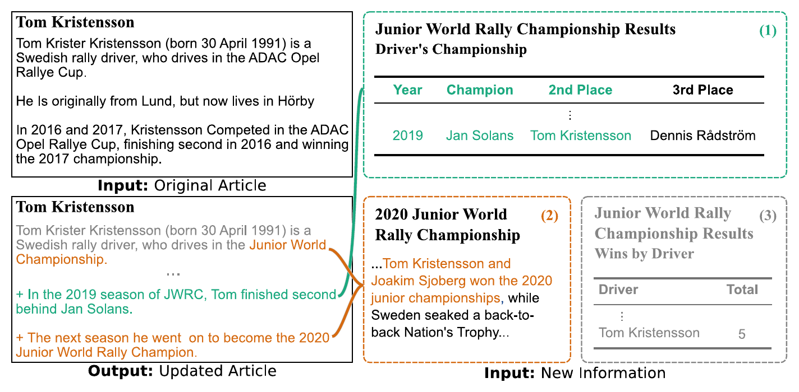
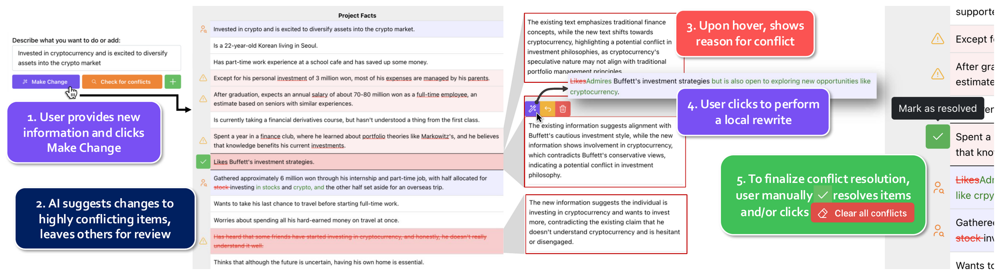
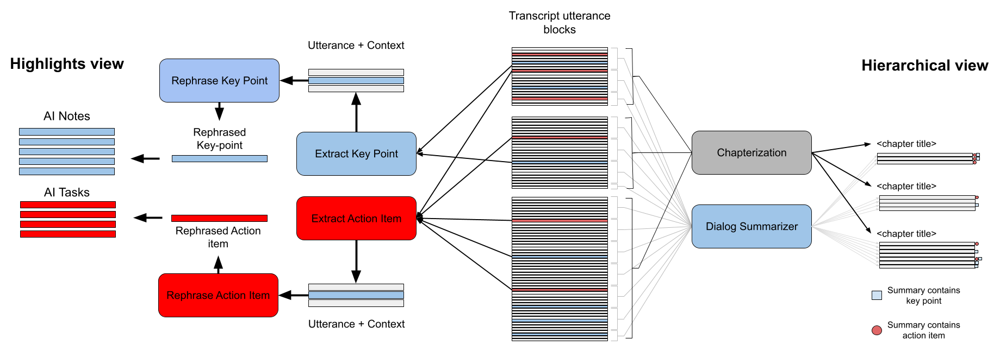
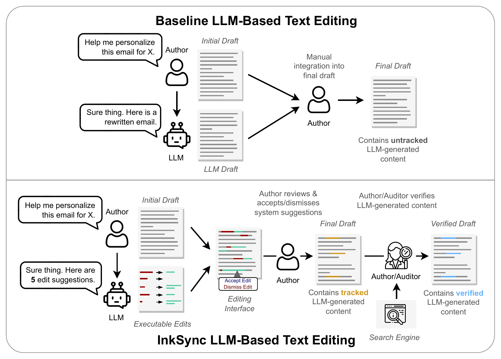
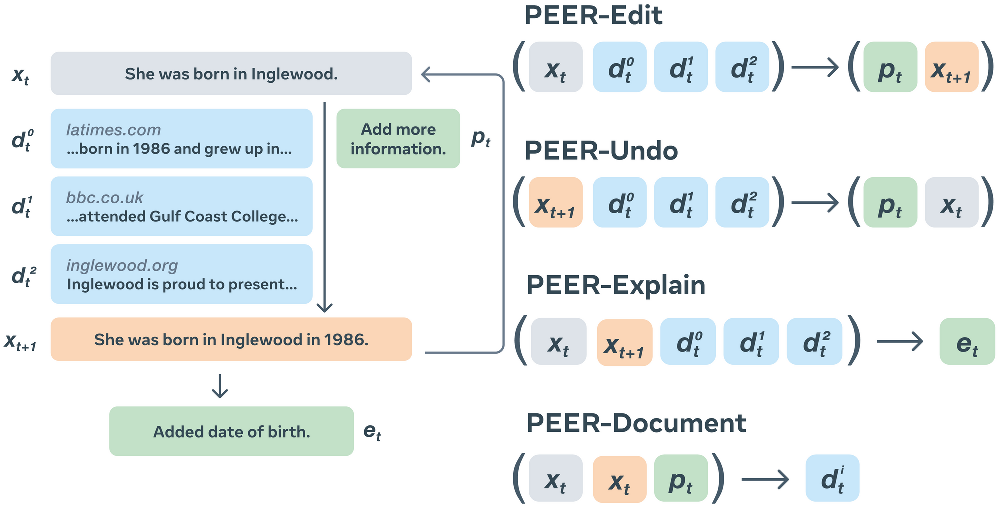
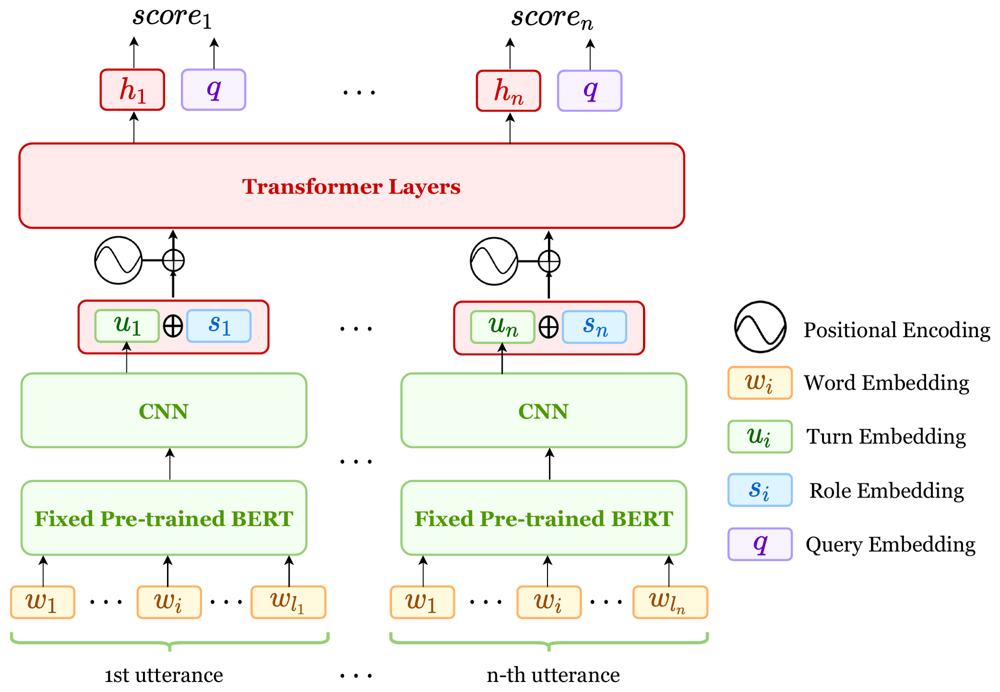
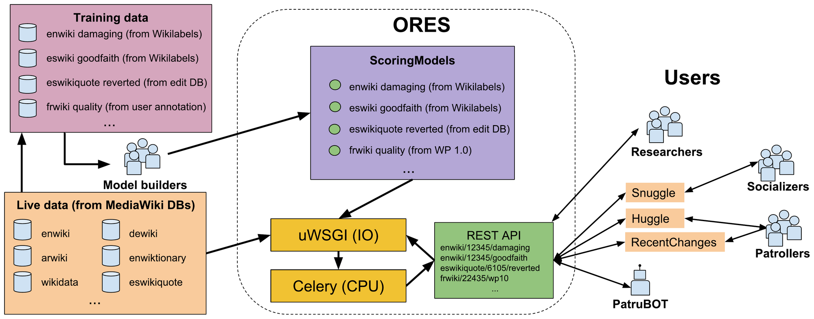

# Scenario B: Meeting digest

> Research notes and candidate applications. Paper findings are reported research; “For us,” “Application,” and proposed pipelines describe ideas to evaluate, not completed lab-wiki capabilities.

The core loop is “the agent proposes → a person reviews → the change enters the record.”

## Top picks

- **Asthana et al., meeting recap system** (B): Microsoft’s LLM meeting recaps, with highlights and action items, evaluated on real meetings.

- **FRUIT** (B, “draft a change per page”): update an existing Wikipedia article from new evidence without writing in unsupported content.

- **Semantic Commit** (B, “find affected pages and build one change set”): detect conflicts and analyze impact before people resolve each one.

## Scenario workflow

Steps on the canvas: meeting ends → transcribe → extract items and tag each as decision / assumption / to-do → find affected pages per item → draft a proposal per page → checks + Verifier → output a meeting record (published automatically) and one change set (sent to review).

### AI / NLP: from meeting to items, and from items to wiki edits

| Paper | Venue | What it solves | What it means for us |
| --- | --- | --- | --- |
| [FRUIT](https://arxiv.org/abs/2112.08634), Logan et al. | NAACL 2022 (Best new task paper, tied) | Update an existing Wikipedia article from new evidence, writing only what the evidence supports | Defines the “draft a proposal per page” task and how to score it; the transcript is our evidence |
| [Semantic Commit](https://arxiv.org/abs/2504.09283), Vaithilingam et al. | arXiv 2025 | When adding new information to an AI memory or spec, detect conflicts and analyze impact before people resolve each one | Very close to B’s “affected pages → change set → review”; its interaction design transfers directly |
| [PEER](https://arxiv.org/abs/2208.11663), Schick et al. | ICLR 2023 | Models human writing as plan, edit, explain, repeat | Every proposal carries a one-line “why” that points to what was said in the meeting |
| [Detecting and Summarizing Action Items in Multi-Party Dialogue](https://aclanthology.org/2007.sigdial-1.4.pdf), Purver et al.; plus [decision detection](https://aclanthology.org/W08-0125.pdf), Fernández et al. | SIGdial 2007 / 2008 | Detects action items by splitting them into sub-roles: task, owner, timeframe, agreement | A field schema for each decision / to-do; flag items with no owner |
| [QMSum](https://arxiv.org/abs/2104.05938), Zhong et al. | NAACL 2021 | Query-based meeting summarization | “Find affected pages” can run in reverse: use each page as a query against the meeting |

### HCI / CSCW: how people review

| Paper | Venue | What it solves | What it means for us |
| --- | --- | --- | --- |
| [Summaries, Highlights, and Action Items](https://arxiv.org/abs/2307.15793), Asthana et al. | PACM HCI (CSCW) 2025 | Designs and field-tests an LLM meeting recap system with highlights and action items | Supports tagging items as decision / assumption / to-do and linking recaps to related material |
| [Beyond the Chat (InkSync)](https://arxiv.org/abs/2309.15337), Laban et al. | arXiv 2023 | Turns LLM suggestions into executable edits, warns about new facts, and supports later auditing | Each edit in a change set should be accept/reject-able, and new facts should be flagged |
| [Principles of Mixed-Initiative User Interfaces](https://www.microsoft.com/en-us/research/publication/principles-mixed-initiative-user-interfaces/), Horvitz | CHI 1999 | Decides whether a system should act, ask first, or do nothing, based on confidence and cost | Rationale for “record published automatically, page edits proposed” |
| [ORES](https://arxiv.org/abs/1909.05189), Halfaker & Geiger | CSCW 2020 | Wikipedia uses ML scores to help human patrollers, and lets communities govern the models | Closest to our governance question; also supports risk ranking in scenario E |

## Paper by paper: Scenario B (ranked by relevance to our system)

### 1. FRUIT: updating existing articles from new evidence

- **Problem:** Knowledge-base articles go out of date. Given an old article and a batch of new evidence, can a model write in only the updates the evidence supports and leave the rest alone?

- **Approach:** (1) Dataset FRUIT-WIKI: compare two Wikipedia snapshots and turn “old article + newly added related sentences from other articles (the evidence)” → “new article” into examples, giving over 170K distantly supervised examples, plus a gold test set of 914 examples where annotators removed content the evidence does not support. (2) Model EDIT5 (T5-based): the input is the old article plus the evidence. The output is not the whole article but edited sentences, copy tokens for unchanged sentences (e.g. [2] means “copy sentence 2”), and reference tokens before each update (e.g. (1) means “this sentence uses evidence 1”). (3) Metrics: ROUGE on the updated parts only (UpdateROUGE), plus an entity-based faithfulness proxy (how many new entities can be found in the evidence).

- **Results:** EDIT5 (3B) reaches UpdateROUGE-1 47.4, above T5-Large with evidence input (44.3). But in a manual check of 100 updates, 35 still contained content the evidence does not support, so faithful updating remains hard. Best new task paper (tied) at NAACL 2022.

- **For us:** B’s “draft a proposal per page” is the FRUIT task, with the meeting transcript as the evidence. “Output only the edits + mark the evidence” matches our diff proposals, and the faithfulness metric can evaluate our Drafter.

System figure: [Figure 1](https://arxiv.org/abs/2112.08634) illustrates the FRUIT task; Figure 3 shows EDIT5’s output format.

*Source: Logan IV et al. 2022, Figure 1, the task illustration (*[arXiv:2112.08634](https://arxiv.org/abs/2112.08634)*). Figure 3 is a text box showing the output format, so it is not reproduced.*

### 2. Semantic Commit: conflict and impact analysis before updating an AI memory

- **Problem:** When adding new information to an existing spec or AI memory, it is hard to know which existing items it conflicts with. Letting the AI rewrite directly can change too much or miss things.

- **Approach:** An interactive tool. After the user submits a new “intent,” a knowledge-graph-based RAG pipeline detects semantic conflicts across the whole document, marks every affected item, and shows a global impact view. The user then resolves each conflict locally: let the AI rewrite, steer a rewrite, apply a suggested resolution strategy, revert a change, or delete the information.

- **Results:** In a 12-user within-subjects study (compared with ChatGPT Canvas), half the participants first ran impact analysis to flag conflicts without AI rewrites and then resolved them locally, even though a one-shot global revision was available. The authors also release a conflict-detection benchmark.

- **For us:** Nearly the same structure as B’s “affected pages → change set → review.” It supports showing reviewers a “which pages did this meeting affect” overview first, then reviewing page by page.

System figure: [Figure 1](https://arxiv.org/abs/2504.09283) shows the SemanticCommit interface; Figure 3 walks through an example workflow.

*Source: Vaithilingam et al. 2025, Figure 3, an example workflow (*[arXiv:2504.09283](https://arxiv.org/abs/2504.09283)*). The workflow figure is shown because it explains the process better than the interface figure.*

### 3. Summaries, Highlights, and Action Items: Microsoft’s LLM meeting recap system

- **Problem:** People have too many meetings and need to know quickly what happened and what they must do. What should LLM meeting recaps look like?

- **Approach:** An LLM pipeline produces two recaps: **highlights** (one- to two-sentence key points and action items) and **hierarchical** (minutes-like chapters with timestamps linked to the transcript). Seven Microsoft information workers tried them on their own recent real meetings, followed by qualitative interviews.

- **Results:** Participants used highlights for a quick overview and the hierarchical recap to understand the discussion. They wanted personalized recaps and links to related organizational material, such as the slides used in the meeting.

- **For us:** Supports tagging items as decision / assumption / to-do and linking the meeting record to wiki pages. Linking to related documents is exactly the step we add beyond an ordinary meeting summary.

System figure: [Figure 4](https://arxiv.org/abs/2307.15793) shows the model pipeline that generates both recaps; Figure 2 shows the recap UI.

*Source: Asthana et al., 2023 preprint / 2025 journal version, the model pipeline from Figure 4 (*[arXiv:2307.15793](https://arxiv.org/abs/2307.15793)*).*

### 4. Beyond the Chat (InkSync): executable, verifiable LLM text editing

- **Problem:** When an LLM edits a document through chat, users must diff versions themselves, and the LLM may quietly add unverified facts.

- **Approach:** LLM suggestions become executable edits inside the document (like track changes, accepted or dismissed one at a time). Three protections sit on top: **Warn** visually flags edits that add new information; **Verify** gives auto-generated search queries to check those facts; **Audit** lets a reviewer trace all system-generated content afterwards.

- **Results:** Compared with a standard chat interface, editing was more accurate and efficient with a better experience. Verification reduced inaccurate edits accepted into the document by 44%, and the audit stage could identify up to 73% of inaccurate edits.

- **For us:** Our proposals are executable edits and should support accepting each one separately. Facts the meeting never stated should be highlighted automatically, and the review history should be kept.

System figure: [Figure 1](https://arxiv.org/abs/2309.15337) gives an overview of the editing and audit interfaces; Figure 3 shows the interface layout.

*Source: Laban et al., 2023 arXiv version, Fig. 1 (*[arXiv:2309.15337](https://arxiv.org/abs/2309.15337)*).*

### 5. PEER: plan, edit, explain, repeat

- **Problem:** People write by revising repeatedly, but language models generate once from left to right and cannot say why they changed something.

- **Approach:** A family of models trained on Wikipedia edit histories. PEER-Edit reads the current text and reference documents and produces a one-line edit plan (e.g. “add a citation”; a person can also give the plan) and the edited text. PEER-Explain writes an explanation for an edit (an edit summary). For domains without edit histories, PEER-Undo, PEER-Explain and PEER-Document synthesize intermediate drafts, plans and reference documents to build synthetic edit histories for training. All models start from LM-adapted T5 (3B).

- **Results:** Follows instructions over multiple rounds of edits, cites reference documents, and explains its own edits; the synthetic data lets it transfer to other domains.

- **For us:** Supports attaching a one-line “why” to every proposal, pointing to what was said in the meeting (our reference documents).

System figure: [Figure 2](https://arxiv.org/abs/2208.11663) shows the PEER process; Figure 1 illustrates its steps.

*Source: Schick et al. 2022, Figure 2 (*[arXiv:2208.11663](https://arxiv.org/abs/2208.11663)*).*

### 6. Detecting action items and decisions in multi-party meetings

- **Problem:** In multi-party meetings, a to-do or decision is rarely stated in one sentence; several people fill it in across turns, so classifying sentence by sentence works poorly.

- **Approach:** Split an action item into dialogue roles: **task description, owner, timeframe, agreement**. Sub-classifiers label each utterance with its role, then a super-classifier looks over a window of turns for whether the roles co-occur; only then is it an action item. Fernández et al. split decisions the same way: **issue, resolution (proposal or restatement), agreement**. Action items use 18 ICSI meetings; decisions use 17 AMI meetings.

- **Results:** On manual transcripts, the hierarchical structure clearly beats flat utterance classification (with ASR output the difference is no longer significant). The output comes structured (who, what, when) and can feed a to-do list directly.

- **For us:** Pre-LLM work, but the data structure still holds. Our decision / to-do items can use these fields and flag “no owner” or “no agreement” for a person to confirm.

System figure: neither paper has one (the figures are F-score and annotation-overlap charts).

### 7. QMSum: query-based meeting summarization

- **Problem:** Meetings are long and each person cares about part of them. Generic summaries are too broad, and long transcripts do not fit in the model.

- **Approach:** (1) Dataset: 1,808 query-summary pairs over 232 meetings in academic, product and committee domains. (2) Method: **locate, then summarize**. A locator finds the spans relevant to the query, and a summarizer (PGNet, BART, HMNet) summarizes only those spans.

- **Results:** Locating first improves summaries: BART’s ROUGE-1 rises from 29.20 to 31.74 and PGNet’s from 28.74 to 31.37. There is still a lot of room to improve.

- **For us:** “Find affected pages” can run in reverse: use each candidate page as the query, locate the relevant meeting spans, then draft that page’s edit.

System figure: [Figure 3](https://arxiv.org/abs/2104.05938), the hierarchical ranking-based locator.

*Source: Zhong et al. 2021, Figure 3 (*[arXiv:2104.05938](https://arxiv.org/abs/2104.05938)*).*

### 8. Principles of Mixed-Initiative User Interfaces

- **Problem:** When should an intelligent assistant act on its own, ask first, or stay out of the way?

- **Approach:** A set of design principles for mixed-initiative interfaces (twelve in the paper), centered on expected-utility decisions: the system estimates the probability that the user wants the action and weighs the benefit of acting correctly against the cost of acting wrongly. This gives two thresholds: above the upper one it acts, between them it asks, below the lower one it does nothing. The example system is LookOut, for scheduling and meeting management.

- **Results:** One of the most cited foundations in human-AI collaboration; it gives a formal basis for graded autonomy.

- **For us:** Motivates considering different autonomy levels for a meeting record and edits to shared pages. “Meeting record published automatically, page edits proposed” is the original scenario proposal; the paper does not establish that an incorrect meeting record is cheap or authorize automatic publication.

**Reference check:** The [author-hosted full paper](https://www.microsoft.com/en-us/research/wp-content/uploads/2016/11/chi99horvitz-1.pdf) confirms twelve principles and the action / dialog / inaction thresholds (Figures 4–6). This supersedes the earlier abstract-only limitation.

### 9. ORES: participatory machine learning that supports human review on Wikipedia

- **Problem:** Wikipedia gets a huge volume of edits, and patrollers need AI to surface suspicious ones. But if the AI decides for people, it can introduce bias and drive away newcomers, and the community cannot correct it.

- **Approach:** Models are offered as a public scoring service (an API) that estimates whether each edit is damaging or made in good faith, and grades article quality. The models only output scores; each community’s tools decide how to use them (filtering, ranking, thresholds). Volunteers can curate labeled data and commission new classifiers for their own community.

- **Results:** Lowered the barrier for communities to build AI tools, and case studies show that crowd-sourced auditing of models is itself an important governance activity. A system and case-study paper focused on governance rather than accuracy.

- **For us:** Closest to our research question: AI only gives risk scores and rankings, people decide, and each lab sets its own rules (thresholds, what counts as high risk). Also applies to scenario E (review prep).

System figure: [Fig. 1](https://arxiv.org/abs/1909.05189), the ORES conceptual overview (model builders train models; ORES hosts them for researchers and tool developers).

*Source: Halfaker & Geiger 2020, Fig. 1 (*[arXiv:1909.05189](https://arxiv.org/abs/1909.05189)*).*

## Related scenario

[Scenario D: Freshness](scenario-d-freshness.md) reuses the evidence-to-edit and impact-analysis patterns with changed source documents instead of meeting transcripts.
