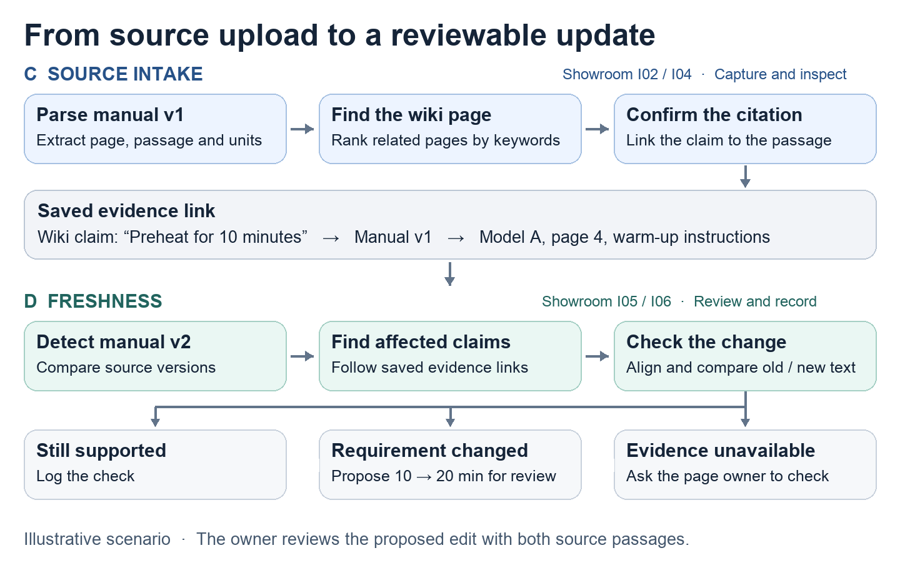
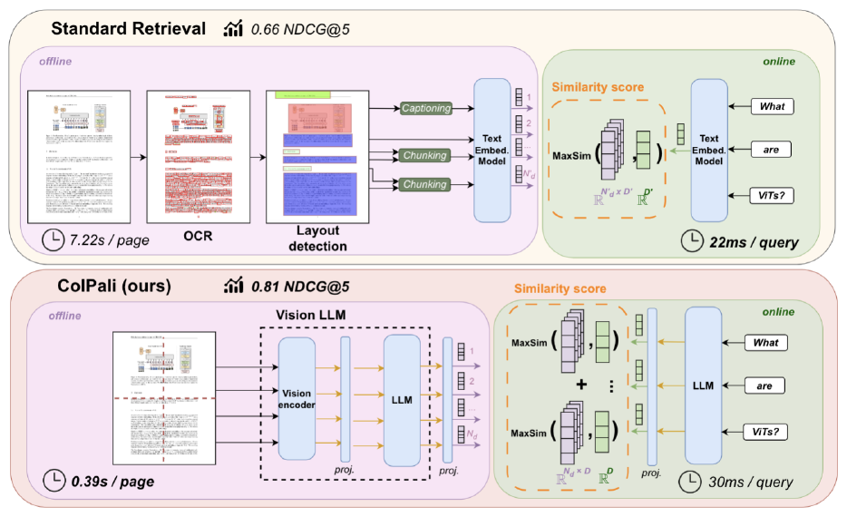
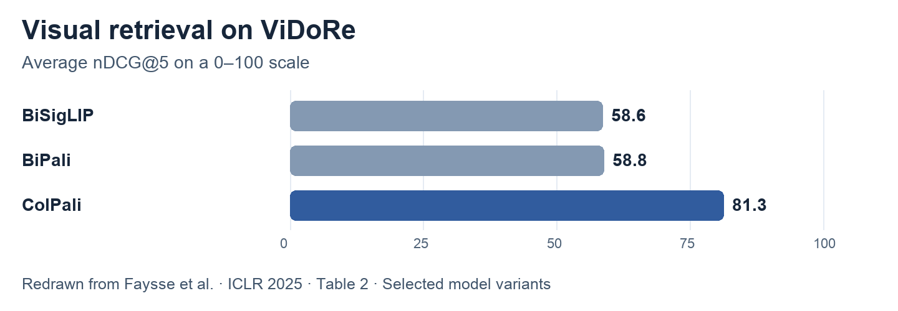

# Scenario C: Source intake

> Research notes and candidate applications. Paper findings are reported research; “For us,” “Application,” and proposed pipelines describe ideas to evaluate, not completed lab-wiki capabilities.

## Source-to-update overview

The saved evidence link connects source intake to the later checks in [Scenario D: Freshness](scenario-d-freshness.md).

## 1. Parse source documents into evidence blocks

### Docling

**How it works.** Docling uses layout analysis to identify elements in PDFs and table structure recognition to recover rows and columns. It converts the document into a structured representation that can be exported as Markdown.

**What stands out.** The parser can retain the hierarchy and table structure that a plain-text PDF dump often loses.

**Application.** Keep the original upload and index its sections, paragraphs, and tables as evidence blocks. Each block should carry a source version, page or section, and a verbatim excerpt. For a table, retain the row label, column header, and units with the value. A scanned page or ambiguous table goes to uploader review when extraction quality makes the recommendation uncertain. [Source ↗](https://arxiv.org/abs/2408.09869)

### Zotero duplicate detection

**How it works.** Zotero uses bibliographic fields such as title, DOI, and ISBN to identify possible duplicates for a person to merge.

**What stands out.** Candidate detection and the merge decision are separate.

**Application.** Use a stable source ID to group versions and a file hash to identify identical bytes. An upload with a matching DOI can be suggested as a related record, with the uploader choosing whether it is another copy, a newer version, or a separate artifact. Keep a preprint and its published version addressable separately when their content differs. [Source ↗](https://www.zotero.org/support/duplicate_detection)

### PubTables-1M (CVPR 2022)

**How it works.** The authors annotate table regions, rows, columns, cells, and header roles in scientific PDFs. Their canonicalization procedure resolves ambiguous splits of spanning cells, and they train a transformer-based detector on the resulting annotations.

**What stands out.** The method separates locating a table, reconstructing its grid, and figuring out what its headers mean. Correctly extracting a cell value still leaves the question of which model and condition it applies to.

**Application.** Keep Docling as the parser. Store a citation to a table cell with its page, table ID, row key, header path, value, and unit. For a multi-model manual, preview the highlighted cell with the header and model row. If the parser cannot resolve a merged header, require the uploader to verify the mapping before saving it as evidence. [Source ↗](https://arxiv.org/abs/2110.00061)

### Chunking baseline: Is Semantic Chunking Worth the Computational Cost? (Qu et al., Findings of NAACL 2025)

**How it works.** The authors compare semantic chunking with fixed-size chunking on document retrieval, evidence retrieval, and retrieval-based answer generation. Semantic methods split or group text by estimated meaning, adding preprocessing work.

**What stands out.** The extra computation did not yield consistent gains across the evaluated tasks. The study supports testing a simpler baseline before adopting a semantic splitter.

**Application.** Start from Docling’s section, paragraph, and table boundaries. Keep the title and model identifier with the indexed block and preserve its page and original span. Compare against fixed windows and a semantic splitter using evidence Recall@5, cross-model errors, and ingest time. [Original paper ↗](https://aclanthology.org/2025.findings-naacl.114/)

## 2. Make evidence links open at the exact passage

### W3C Web Annotation

**How it works.** TextPositionSelector stores character offsets. TextQuoteSelector stores exact text, with optional prefix and suffix for disambiguation.

**What stands out.** The same excerpt can be located by position within a known version and by text when layout changes.

**Application.** A PDF citation should store source ID, source version, page or section, and the exact excerpt with surrounding text. Clicking the citation in Figma’s evidence view would open that version at the cited passage. Save the original excerpt separately from generated summaries. [Source ↗](https://www.w3.org/TR/annotation-model/)

### Hypothesis fuzzy anchoring

**How it works.** Hypothesis documents a staged process that uses saved positions and exact or approximate quote matching with surrounding context to recover annotations after text changes.

**What stands out.** A moved paragraph can often be found again without throwing away the annotation.

**Application.** On v2, try the old location, then a unique exact quote match, then contextual matching. A fuzzy match should propose a new location. If it changes a quantity, unit, negation, or scope, the match still requires evidence review. If two passages look plausible, show the candidates and let the reviewer choose. [Source ↗](https://web.hypothes.is/blog/fuzzy-anchoring/)

## 3. Rank related wiki pages for the uploader

### Keyword search and BEIR

**How it works.** The original architecture proposal assumes index.md, keyword search, and anchored reads. BEIR compares lexical, dense, and reranking systems across diverse retrieval tasks and finds BM25 a strong baseline.

**What stands out.** Exact matches for equipment identifiers, acronyms, and protocol names are easy to inspect.

**Application.** Query the index with the source title, section headings, model numbers, and recognized entities. Rank existing pages and show up to five suggestions, each paired with the source excerpt and a short reason. Check whether human-labeled target pages appear in the top five before adding another retrieval layer. [Source ↗](https://arxiv.org/abs/2104.08663)

### Librarian Agents

**How it works.** A builder agent reorganizes documents into a hierarchical file workspace with synthetic files and reference links. The authors train the builder to improve a downstream answering agent’s performance.

**What stands out.** It invests in organizing a corpus at intake so future queries can reuse that work.

**Application.** Borrow the workspace pattern by suggesting an entry in index.md or a link under the equipment or project directory. Keep each generated entry tied to the original source. The lab can use and evaluate that pattern with an ordinary keyword index and uploader confirmation. [Source ↗](https://arxiv.org/abs/2610.22273)

### Contextual Retrieval

**How it works.** Anthropic adds a brief document-specific context to each chunk before lexical and vector indexing.

**What stands out.** An isolated chunk can be retrieved by concepts established elsewhere in its document.

**Application.** If the index misses “warm up for 20 minutes” because the instrument name appears only in the heading, prepend the instrument, version, and section to the indexed text. Display and verify the original passage separately. Compare this change against plain keyword search on actual missed cases. [Source ↗](https://www.anthropic.com/research/contextual-retrieval)

### PageIndex

**How it works.** The project builds a document tree resembling a table of contents, then navigates nodes to select relevant sections.

**What stands out.** It uses document hierarchy to narrow a search.

**Application.** Try it on long manuals where multiple instrument models have similar instructions. Search the correct model’s section before retrieving its operating steps. Keep the same search tool interface so it can return comparable excerpts and locations. [Source ↗](https://github.com/VectifyAI/PageIndex)

### ColPali (Faysse et al., ICLR 2025)

**How it works.** A PaliGemma-based encoder indexes rendered PDF pages as multiple patch vectors. Each query token matches its best-scoring patch, and the scores are summed to rank pages. The paper compares this visual path with a conventional parse-and-index workflow.

**What stands out.** In ViDoRe Table 2, ColPali reached 81.3 average nDCG@5, versus 58.8 for BiPali and 58.6 for BiSigLIP. These are page-ranking results on the paper’s benchmark. A ranked page still needs a precise citation.

**Application.** Keep structured text as the default. Try the visual retriever when a scanned SOP, figure, or layout-heavy table defeats text search. Retrieve a page first, then use the parser or a reviewer to confirm the bounding box and verbatim passage. Measure page Recall@5, then measure whether the accepted citation identifies the correct row or region. [Original paper ↗](https://proceedings.iclr.cc/paper_files/paper/2025/file/99e9e141aafc314f76b0ca3dd66898b3-Paper-Conference.pdf#page=7)

**Paper visual.** Figure 1 compares the two indexing pipelines. The chart below redraws selected ViDoRe results from Table 2. [View figure ↗](https://proceedings.iclr.cc/paper_files/paper/2025/file/99e9e141aafc314f76b0ca3dd66898b3-Paper-Conference.pdf#page=2)

[Faysse et al.](https://proceedings.iclr.cc/paper_files/paper/2025/file/99e9e141aafc314f76b0ca3dd66898b3-Paper-Conference.pdf#page=2) *(2025), Figure 1. Compare the text extraction pipeline above with page-image encoding and patch matching below.*

### ConTEB and InSeNT (Conti et al., 2025 preprint)

**How it works.** ConTEB evaluates passages whose relevance depends on surrounding document context. InSeNT uses contrastive training with negatives from the same sequence. It combines this training with late chunking, where a model encodes surrounding text before pooling the vectors for each passage.

**What stands out.** The authors report improved retrieval on context-dependent examples. Nearby passages about different models can be very similar when encoded as isolated snippets.

**Application.** Use same-document hard negatives in the lab evaluation, such as identical warm-up headings for two instruments. First compare a baseline that carries the source title and model heading into the query index. If it still fails, test contextual embeddings. The evidence shown to the reviewer should remain the original passage. [Original paper ↗](https://arxiv.org/abs/2505.24782)

## 4. Separate related material from evidence for a claim

### Citation Needed

**How it works.** Redi and colleagues derived a taxonomy of why Wikipedia claims need citations using editorial policies and editor judgments, then evaluated models that predict when and why a citation is needed.

**What stands out.** It makes the reason for an evidence request explicit.

**Application.** Build a small lab-specific labeling guide from examples. A meeting note may establish that a procedure was proposed. An approved SOP may establish what the lab currently requires. The intake dialog can suggest a knowledge type and evidence role, with the uploader able to change both. [Source ↗](https://arxiv.org/abs/1902.11116)

### PROV-O

**How it works.** The standard represents entities, activities, and agents, and describes relations such as derivation and generation.

**What stands out.** It supports tracing a statement or artifact to its inputs and the activity that produced it.

**Application.** Store two relations. A related-to link connects a source to a relevant page. A cites link connects a specific wiki claim to a versioned passage and records who confirmed it. Use Markdown metadata or a small link index. Freshness can then use claim-level citations where available and page-level review where only a related link exists. [Source ↗](https://www.w3.org/TR/prov-o/)

### ALCE

**How it works.** ALCE evaluates generated text with citations, including whether the cited passages support the corresponding statements and whether claims needing support are covered.

**What stands out.** It treats coverage and support as distinct questions.

**Application.** Check verbatim quote existence in code. Separately assess whether the passage supports the exact claim, including the correct instrument, condition, and time. For an intake suggestion that is merely topical, label it as related and leave the evidence role for a person to confirm. [Source ↗](https://aclanthology.org/2023.emnlp-main.398/)

### Table-Text Alignment (2025 preprint)

**How it works.** The authors extend the SciTab scientific table verification dataset with human-annotated cell-level rationales, so a claim verdict can be evaluated alongside the cells used to justify it.

**What stands out.** It makes evidence selection testable at the cell level. A correct verdict paired with the wrong row can be caught.

**Application.** For claims derived from tables, let the uploader confirm the evidence cells as well as the target page. In the microscope example, link the warm-up value to the model cell and unit header. Save the selected cells as a set so Freshness can recheck a changed value or a changed condition. [Source ↗](https://arxiv.org/abs/2506.10486)

### ReClaim (Xia et al., Findings of NAACL 2025)

**How it works.** ReClaim interleaves reference and claim generation in long-form answers, producing sentence-level attribution. The selected reference conditions the next claim.

**What stands out.** The method makes each sentence and its evidence a pair, which is easier to inspect than one bibliography for a whole paragraph. The authors report 90% citation accuracy in their experiments.

**Application.** For an existing wiki, reverse the generation setting into a review action. Given a selected wiki sentence, have the system propose an exact passage ID from the uploaded source, then let the uploader confirm the pair. Validate that the ID and quote resolve to the stored snapshot. Keep page-level recommendations and confirmed claim citations as separate record types. [Original paper ↗](https://aclanthology.org/2025.findings-naacl.55/)

### C in the Showroom

Use I02 to show the material being captured and I04 to show the original evidence opening in context. In the proposed upload dialog, each suggestion shows a target page, the excerpt, and the reason for the match. Uploader confirmation saves the selected relationship. [Source ↗](https://www.figma.com/design/fm5zX32mbG13hahShVgJwd/Agentic-Collaborative-Wiki?node-id=1838-314)

[I04 · Inspect the evidence](https://www.figma.com/design/fm5zX32mbG13hahShVgJwd/Agentic-Collaborative-Wiki?node-id=1838-839)
