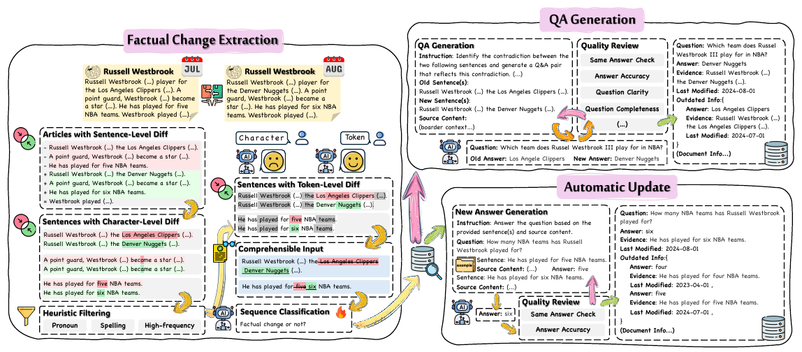
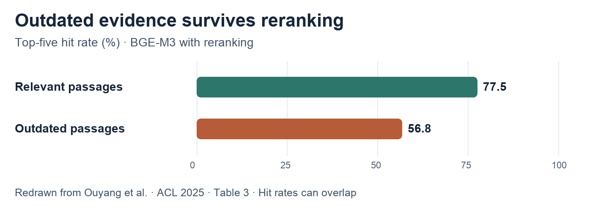
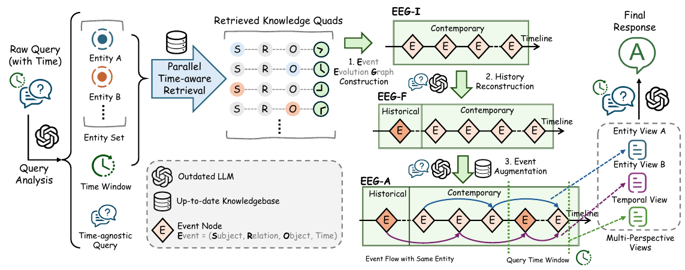

# Scenario D: Freshness

> Research notes and candidate applications. Paper findings are reported research; “For us,” “Application,” and proposed pipelines describe ideas to evaluate, not completed lab-wiki capabilities.

## 1. Detect and classify a source change

### Version comparison and HTTP validators

**How it works.** The draft starts from a file hash or a scheduled check. HTTP supports conditional retrieval with validators such as ETag and Last-Modified where the host provides them.

**What stands out.** A cheap check can avoid rerunning the model on every source.

**Application.** Store the last observed source version. If it changes, retrieve or open the new snapshot, normalize extracted text, and compare cited passages. Formatting-only byte changes can end with a check record. If a source is unavailable, keep the last successful version and record the attempted check as incomplete. [Source ↗](https://www.rfc-editor.org/rfc/rfc9110.html)

### Crossmark and Retraction Watch

**How it works.** Crossmark communicates publisher-registered corrections, retractions, and other updates. Crossref also exposes Retraction Watch data.

**What stands out.** The status of a publication can change even if a downloaded PDF has the same hash.

**Application.** For DOI-backed material, treat a correction or retraction notice as its own source event. Find wiki claims that cite the affected work and show the notice in the review item. A reviewer can decide whether another source supports the claim or whether it needs revision. [Source ↗](https://www.crossref.org/services/crossmark/)

[Crossref · Retraction Watch data](https://www.crossref.org/documentation/retrieve-metadata/retraction-watch/)

### arXivEdits (EMNLP 2022)

**How it works.** Jiang and colleagues annotate sentence alignment across versions of scientific papers and use a neural CRF for sentence alignment. They then model edit extraction as span alignment to locate the words that changed inside matched sentences.

**What stands out.** Finding the corresponding sentence and identifying what changed inside it are separate operations. That separation gives the reviewer a smaller, more interpretable diff.

**Application.** In get_source_diff, pair passages by stable section and exact match first. For unmatched passages, rank candidates by section, surrounding context, and text similarity. Compute a word-level diff within each aligned pair and preserve quantities, units, negation, and conditions. When alignment is ambiguous, mark the citation unresolved. Evaluate on moved paragraphs and revised instructions separately. [Source ↗](https://aclanthology.org/2022.emnlp-main.641/)

### HoH (Ouyang et al., ACL 2025)

**How it works.** The benchmark compares dated Wikipedia snapshots using sentence-level Myers diff, finer-grained text differences, and semantic screening. Its retrieval experiments explicitly track relevant and outdated passages as separate categories.

**What stands out.** In Table 3, BGE-M3 with reranking had a 77.54% top-five hit rate for relevant passages and 56.78% for outdated passages. A search can return both. Similarity and reranking alone leave a substantial version-selection problem.

**Application.** Use a source event to locate the old and new snapshots by ID. Compute a local diff, then pass named old and new passages to the verifier with their version, effective date, and scope. Test current-only, old-only, and mixed evidence. The old-only case should yield a stale or unresolved status when the current version is required. [Original paper ↗](https://aclanthology.org/2025.acl-long.301.pdf#page=7)

**Paper visual.** Figure 2 shows how the authors build examples from revisions. The chart below redraws the BGE-M3 reranking condition from Table 3. [View figure ↗](https://aclanthology.org/2025.acl-long.301.pdf#page=4)

[Ouyang et al.](https://aclanthology.org/2025.acl-long.301.pdf#page=4) *(2025), Figure 2. The left panel shows how the benchmark isolates factual changes between source versions.*

## 2. Find the affected claims without scanning the whole wiki

### Incremental view maintenance

**How it works.** Database research propagates changes in underlying relations to affected derived views.

**What stands out.** Explicit dependencies constrain the amount of work.

**Application.** Implement the proposed list_backlinks as a reverse index from source to passages, claims, and pages. get_source_diff identifies changed or missing passages in the new version. Recheck directly dependent claims first. If a page has only a coarse link, show “page review needed” and explain why the system cannot localize the change. Refresh dependencies after an approved edit so future checks follow the current citations. [Source ↗](https://doi.org/10.1145/170036.170066)

### Dependabot

**How it works.** GitHub can identify a vulnerable software dependency and open a pull request to update it.

**What stands out.** A known dependency turns an external event into a specific reviewable change.

**Application.** Borrow the workflow shape for a changed source. Generate one review item for each affected page with the change reason and evidence. Group repeated detections of the same source revision so reviewers can work from one current proposal. [Source ↗](https://docs.github.com/en/code-security/concepts/supply-chain-security/dependabot-security-updates)

## 3. Judge whether new evidence changes the claim

### SciFact

**How it works.** SciFact retrieves abstracts that support or refute a scientific claim and identifies the rationale sentences for the label.

**What stands out.** It links the verdict to a specific piece of evidence.

**Application.** Give the verifier a single wiki claim, the previously cited passage, and the candidate passage in the new source. Ask for a verdict with exact evidence spans. Use three review outcomes: still supported, potentially affected, or insufficient evidence. For “preheat for 10 minutes,” a v2 instruction of “20 minutes” for the same model and conditions supports a correction. A 20-minute instruction for another model leaves the first claim unresolved unless its own evidence is found. [Source ↗](https://aclanthology.org/2020.emnlp-main.609/)

### WikiChat

**How it works.** WikiChat uses retrieval and fact checking to ground claims in candidate responses before producing a final answer.

**What stands out.** Checking separate claims makes unsupported pieces easier to locate.

**Application.** Split a sentence such as “preheat for 10 minutes and recalibrate after every run” into two checks. If the new manual changes only preheat time, the proposal should touch only that instruction. Keep the support judgment and exact quote check separate. [Source ↗](https://arxiv.org/abs/2305.14292)

### Time-Aware Evidence Ranking

**How it works.** This work incorporates temporal information into evidence ranking for fact checking.

**What stands out.** The dates attached to a claim and its evidence can affect whether they match.

**Application.** Track the source revision, its effective date, and the protocol or instrument version it covers. If v2 becomes effective next week, the proposal can show when the new instruction applies. Keep historical statements linked to the version that was in force at the time. [Source ↗](https://arxiv.org/abs/2009.06402)

### VitaminC (NAACL 2021)

**How it works.** The authors use factual Wikipedia revisions and synthetic examples to build contrastive evidence pairs. The wording remains very similar, but a factual edit can change whether the evidence supports a claim.

**What stands out.** A verifier can fail even when it retrieves almost exactly the right passage. It must react to the few words that determine the verdict.

**Application.** Build paired checks for 10 versus 20 minutes, minutes versus seconds, and Model A versus Model B. Pair them with formatting-only changes. Compare a text-similarity baseline with a verifier that must quote the changed span and match the model, unit, and condition. Count missed corrections and false alerts separately. [Source ↗](https://aclanthology.org/2021.naacl-main.52/)

### SciVer (ACL 2025)

**How it works.** SciVer uses expert-annotated examples from scientific papers to evaluate verification with multimodal evidence. Its experiments compare model performance with expert judgments and examine retrieval quality and model errors.

**What stands out.** A verifier may have to combine prose, tables, and figures. A correct text excerpt can still omit the visual evidence that determines the verdict.

**Application.** When a claim cites a figure or a table, pass the relevant crop plus its caption and associated extracted values. If the system cannot read an axis, unit, or figure legend with confidence, keep the result unresolved and show the original crop for manual review. [Source ↗](https://aclanthology.org/2025.acl-long.420/)

### (D)RAGged Into a Conflict (2025)

**How it works.** The researchers define conflict categories and desired response behaviors, then use expert annotations to identify conflict types in realistic retrieval-augmented examples.

**What stands out.** Different conflicts call for different responses. Two documents can disagree because they apply to different conditions or because they make genuinely incompatible recommendations.

**Application.** Before drafting a correction, compare source authority, effective date, and scope. If a current lab SOP and a vendor manual give different warm-up times, show both passages with their scope and dates. If policy gives one source precedence for this instrument, explain the rule. Otherwise, route the conflict to the page owner with both citations. [Source ↗](https://research.google/pubs/dragged-into-a-conflict-detecting-and-addressing-conflicting-sources-in-retrieval-augmented-llms/)

### Chronos: RAG or Learning? Understanding the Limits of LLM Adaptation under Continuous Knowledge Drift in the Real World (Liu et al., Findings of ACL 2026)

**How it works.** Chronos extracts entities and a time window, retrieves timestamped subject–relation–object facts, and organizes them into an Event Evolution Graph with entity links and ordered timelines.

**What stands out.** Its experiments expose temporal inconsistency under continuous knowledge drift. The method gives the model explicit temporal structure rather than relying on a date buried in retrieved prose.

**Application.** Use the idea at smaller scale with a version timeline for each source. Store release time and effective time separately. A current-instruction query selects the revision effective at the requested date and matching the instrument model. A historical query can still resolve the previous revision. Use the graph only if cross-source dependencies justify it. [Original paper ↗](https://aclanthology.org/2026.findings-acl.546.pdf#page=4)

**Paper visual.** Figure 2 shows the progression from a time-scoped query to an event graph and a final answer. [View figure ↗](https://aclanthology.org/2026.findings-acl.546.pdf#page=4)

[Liu et al.](https://aclanthology.org/2026.findings-acl.546.pdf#page=4) *(2026), Figure 2. Follow the time window from query analysis through retrieval and the event timeline.*

## 4. Turn the verdict into a reviewable action

### Tettra content verification

**How it works.** Teams assign verification responsibility and review frequency for knowledge-base pages.

**What stands out.** The workflow gives a person an explicit review task and a visible verification state.

**Application.** A timer can create a review-due item even when no source has changed. A source-driven item can also show the affected sentence, old and new evidence, and the trigger. Store freshness check status separately from human approval status. [Source ↗](https://support.tettra.com/collaborating-on-pages/how-to-set-up-verification-and-verify-page-content)

### GitHub stale review handling

**How it works.** GitHub can dismiss approvals when new changes invalidate the diff that was reviewed.

**What stands out.** Approval is tied to the content that the reviewer saw.

**Application.** Bind the proposal to a page revision and source version. Before acceptance, compare both versions. If another edit changed the page or the source changed again, refresh the evidence and re-review the proposal. Git is one way to store revision IDs. The same behavior can be shown with two saved versions in the design walkthrough. [Source ↗](https://docs.github.com/en/repositories/configuring-branches-and-merges-in-your-repository/managing-protected-branches/about-protected-branches)

### Guidelines for Human–AI Interaction

**How it works.** Amershi and colleagues provide guidelines including support for efficient correction and clear recovery when the system is uncertain.

**What stands out.** Correcting the system is part of the interaction design.

**Application.** The review card shows the proposed edit beside the old and new evidence. The reviewer can accept, edit, reject, or request clarification. With a verified non-material change, record the check. With missing evidence, keep the item open and surface why a decision could not be made. [Source ↗](https://www.microsoft.com/en-us/research/wp-content/uploads/2019/01/Guidelines-for-Human-AI-Interaction-camera-ready.pdf)

### Semantic Commit (Vaithilingam et al., 2025 preprint)

**How it works.** The system uses graph-based retrieval to find statements that can conflict with a proposed update, then separates impact analysis and user review from generating edits. Its within-subjects study compares the review workflow with ChatGPT Canvas.

**What stands out.** The interface lets a person see where a change might propagate and choose which conflicts to resolve. The authors report greater engagement without a statistically significant increase in reported workload in their study.

**Application.** Reuse the interaction from Scenario B for Scenario D. Start from explicit citation backlinks and show affected pages before drafting. Group proposals by source revision. Mark explicit citation dependencies separately from textually similar pages and let the reviewer accept or skip each change. A broader semantic search is an optional second pass for missing links. [Original paper ↗](https://arxiv.org/html/2504.09283v1)

### FRUIT (Logan et al., NAACL 2022)

**How it works.** FRUIT gives systems an old Wikipedia article and new evidence, then asks them to update the article. It evaluates evidence-grounded editing and includes EDIT5, a T5-based editing approach.

**What stands out.** The task separates bringing an article up to date from generating an article from scratch. Unchanged facts are part of what a good edit should preserve.

**Application.** Reuse Scenario B’s evidence-to-edit pattern with a changed manual as input. Draft a narrow replacement for the affected wiki sentence, include old and new excerpts, and run checks for unsupported additions. Show the minimal diff in I05 and leave the page owner to approve it. Compare edit locality and support against a whole-page rewrite baseline. [Original paper ↗](https://aclanthology.org/2022.naacl-main.269/)

## Related scenarios

[Scenario C: Source intake](scenario-c-source-intake.md) establishes the versioned evidence and claim links used here. [Scenario B: Meeting digest](scenario-b-meeting-digest.md) contains the longer FRUIT and Semantic Commit discussions. Their use for wiki maintenance remains a proposed adaptation.

**Reference-check clarification:** HoH is a benchmark-construction and evaluation method. Its diff pipeline and retrieval results do not establish a working source-to-wiki maintenance system. GitHub stale-approval dismissal is a configurable feature, not a behavior of every repository.
